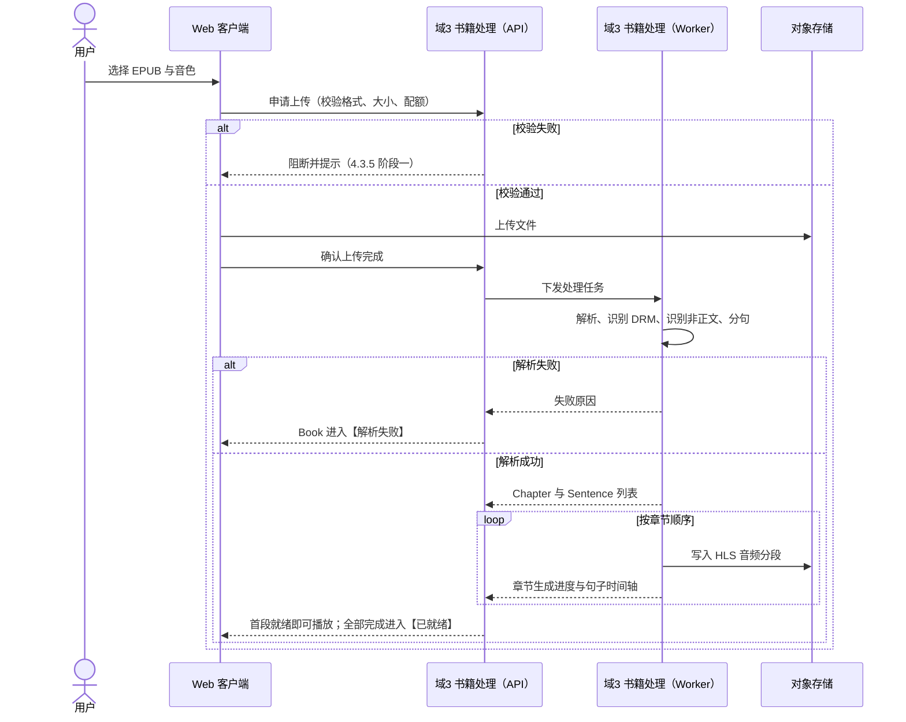
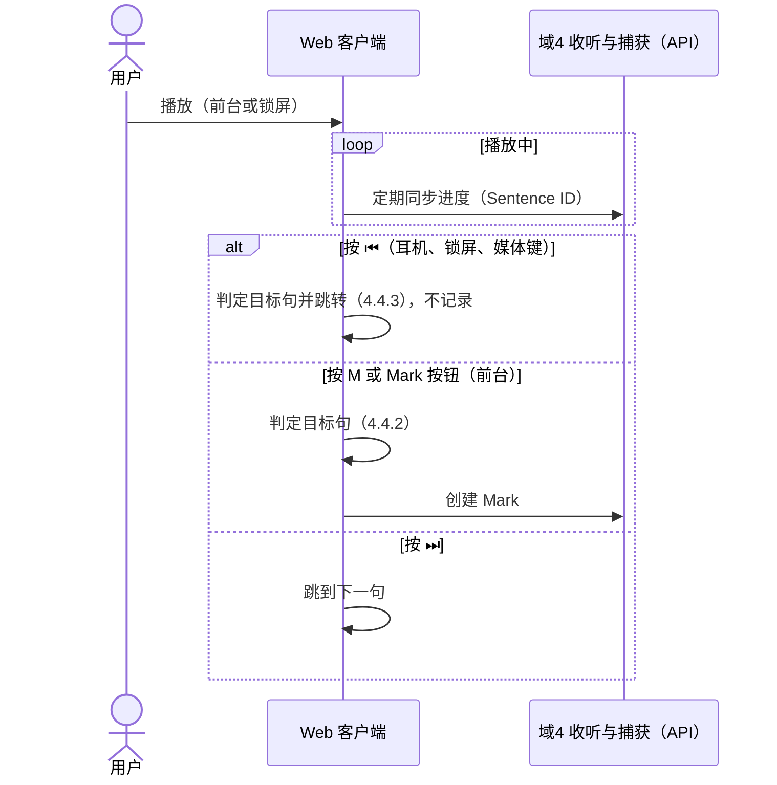
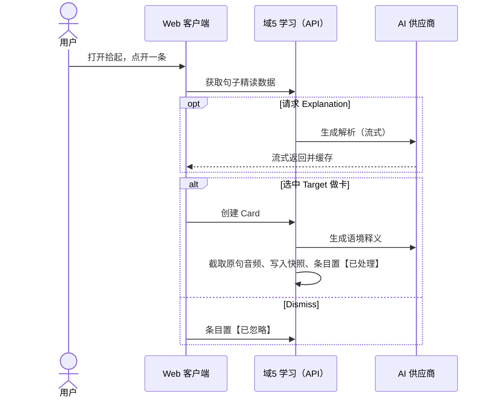
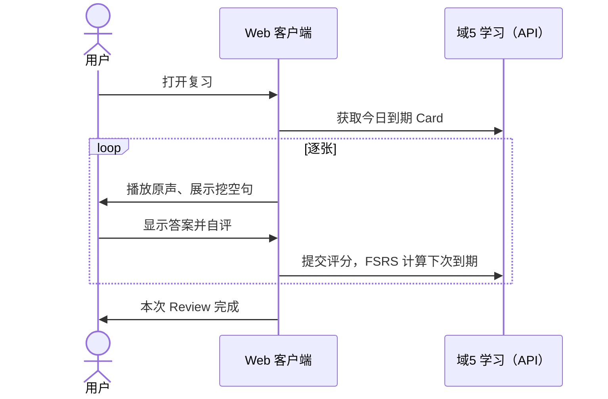
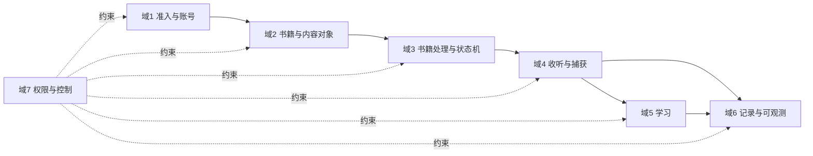

# VocaLeaf MVP PRD

# 文档信息

| **文档版本** | V1.5 | **状态** | 草稿 |
| --- | --- | --- | --- |
| **产品名称** | VocaLeaf（中文名：拾页） | **创建日期** | 2026.11.17 |
| **产品经理** | @Allen | **更新日期** | 2026.11.18 |
| **评审人** | 产品 / 研发 | **目标上线** | 待定（见 6.3 O5） |

# 修订记录

| **版本** | **日期** | **修订人** | **修订说明** |
| --- | --- | --- | --- |
| V1.0 | 2026.11.17 | @Allen | 初稿，依据 2026.11.17 需求梳理会议结论（Q1 至 Q23）落文 |
| V1.1 | 2026.11.17 | @Allen | 确认 D1 至 D5 并删除标注；4.1.1 改为不支持注销；4.6.3 改为不做告警、只记日志；4.7.2、6.4 AI 模型改为部署配置；3.2 增加 14、15；删除 6.3 G2、G3、O2 |
| V1.2 | 2026.11.17 | @Allen | 删除 TXT 支持（R2、4.2.1、4.2.5、4.3.2、4.3.5 #1 #7、AC-UP-01 AC-UP-10、3.2 #1）；4.5.2 背面不可编辑，只可重新生成，增加 AC-CLIST-04；删除 6.3 G1、G4 |
| V1.3 | 2026.11.18 | @Allen | 同步桌面 Web 设计稿 V1.0.0：【拾叶】改名【拾起】、【句子面板】改名【句子精读】、产品中文名【拾页】；桌面迷你播放条改为侧栏当前收听入口；播放页改为专注页（F7、F9 重写）；句子精读改为固定原句加聊天（4.5.1、F11 重写）；新增收听会话与试听规则（4.4.1）、句子状态与点击规则（4.4.5）、F16 卡片浮窗、R21；Card 在正文按 Target 显示；补 F10、F12、F13 交互；新增 6.3 O7 至 O9 与 6.5 交互细节待确认 |
| V1.4 | 2026.11.18 | @Allen | 取消 Replay（⏮ 只跳转不记录，拾起只收 Mark，移入 3.3）；进度拖动按音频位置续播；章节读完自动进入下一章、全书读完自动暂停；忽略需二次确认；名称统一为 VocaLeaf，中文名拾页；关闭 6.3 O7 与 6.5 G1、G3、G4、G11 |
| V1.5 | 2026.11.18 | @Allen | 句子精读默认收起；点击有 Card 的句子打开卡片浮窗，点击没有 Card 的句子展开句子精读；卡片浮窗占用右侧区域，不与句子精读同时出现（4.4.5、F7、F11、F16）；关闭 6.5 C2 |

关联文档：

- 领域词汇表：[CONTEXT.md](../CONTEXT.md)
- 架构决策：[ADR 0001 自建 TTS 流水线](adr/0001-own-tts-pipeline-not-ebook2audiobook.md)、[ADR 0002 API 优先](adr/0002-api-first-ts-api-owns-db.md)
- 调研：[竞品与 TTS 调研](research/2026-11-17-competitors-and-tts.md)
- 设计稿：Pencil 主稿（含手机端与桌面端，文件名沿用旧名《VocalLeaf 拾叶》）；桌面 Web 的尺寸与像素级说明见 Pencil 开发说明稿（文件名《VocalLeaf V1.0.0》）。
  手机端只同步了命名、句子样式与图标，句子精读的聊天形态与卡片浮窗尚未适配（见 6.3 O8）。

命名约定（V1.3 起）：

- 产品英文名统一为 VocaLeaf，中文名为【拾页】；设计稿、界面、文档中的其他拼写一律改为 VocaLeaf。
- Gleanings 的界面名称为【拾起】（原【拾叶】）。
- 句子侧栏的界面名称为【句子精读】（原【句子面板】）。
- 页面内的 ⏮ 与 ⏭ 按钮分别称【重听】【下一句】，图标为逆时针与顺时针箭头，中央带数字 1；本文在描述系统媒体控件时仍写 ⏮⏭。

# 一、用户与场景

## 1.1 目标用户

| **类别** | **角色** | **描述** | **核心诉求** |
| --- | --- | --- | --- |
| 外部 | 中文母语的英语学习者（内测邀请用户） | 有一定英语基础，想读英文原版书但抽不出整块时间，通勤、运动、做家务时习惯听东西 | 把手里的英文书变成能挂后台听的有声书；听到不懂的地方能顺手记下，事后弄懂并记住 |
| 外部 | 产品负责人本人（第一用户） | 同上，同时负责判断产品是否成立 | 连续 4 周真实使用，体感与数据对得上 |
| 内部 | 运营管理员（本期由产品负责人兼任） | 管理内测白名单、Library 书单、限额，处理侵权通知 | 无独立后台也能完成日常运营操作（见 6.2） |

## 1.2 使用场景

- **核心场景**：用户在手机浏览器打开一本英文书，锁屏后挂后台听；没听清就按 ⏮ 回到这句再听一遍；想事后弄懂的句子，在前台点一下【标记】；之后坐下来在拾起里把这些句子弄懂、做成 Card，再按计划复习。不做的话，用户要么只能听懂个大概、没懂的地方转瞬即逝，要么得停下来查词，听书就变成了精读，坚持不下去。
- **形态枚举**：
  - **纯听**：锁屏或后台，不看屏幕，只用 ⏮⏭ 和播放暂停。
  - **边听边看**：前台打开阅读视图，句级跟读，可随时 Mark。
  - **坐下来学**：处理拾起，看 Explanation、追问、制作 Card。
  - **复习**：Review 到期 Card。
- **典型业务场景**

| **业务场景** | **前置条件** | **动作** | **具体描述** |
| --- | --- | --- | --- |
| 通勤听书 | 书架上有已可播放的书 | 锁屏播放，遇到没听清的句子按耳机或锁屏的 ⏮ | 播放回到该句开头重听；不产生任何记录 |
| 电脑前边听边看 | 桌面浏览器打开专注页 | 按 `M` 或点 Mark 按钮 | 当前句被标记为 Mark，进入拾起 |
| 晚上处理拾起 | 拾起有待处理条目 | 打开拾起，逐条打开句子精读 | 看 Explanation、追问，选中 Target 做成 Card，或 Dismiss |
| 睡前复习 | 有到期 Card | 打开复习 | 听原声、看挖空句，回想后翻面并自评 |
| 新用户首次体验 | 刚登录，书架为空 | 从 Library 加一本书 | 立即开始听，无需上传 |
| 上传自己的书 | 有无 DRM 的 EPUB | 上传 | 几十秒内可开始听，后台继续生成全书 |

# 二、背景与目标

## 2.1 背景与痛点

### 2.1.1 背景

中文母语用户想通过英文原版书提升英语，目前有四条路径：

1. **买官方有声书**（Audible 等）：真人朗读，只覆盖部分书，价格高，与电子书分开购买。
2. **用通用 TTS 朗读工具**（Speechify、ElevenReader、NaturalReader）：上传文件即可听，体验接近有声书，但完全没有学习功能。
3. **用语言学习阅读器**（LingQ、Readlang）：点词翻译、生词本、SRS，但以精读为主，需要盯着屏幕。
4. **自己拼工具链**：电子书阅读器加词典加 Anki，或用 ebook2audiobook 这类开源工具自己转音频。

### 2.1.2 痛点

- **听和学是割裂的**：TTS 工具只管听，学习工具只管读，听的时候遇到不懂的地方没法捕获，事后也找不回来。
- **学习工具要求盯屏**：LingQ 类产品的点词、标注都依赖看着屏幕，与"挂后台听"的碎片时间场景冲突。
- **生词脱离语境**：传统生词本只存单词和词典释义，丢失了原句和原声，"run" 在这本书里是"经营"还是"跑"已经无从得知。
- **自建门槛高**：ebook2audiobook 需要 GPU、命令行，默认模型禁止商用，且没有任何学习功能。

### 2.1.3 小结

现有路径要么只能听，要么只能精读，没有一个产品把"挂后台听"和"顺手学"连成闭环。
VocaLeaf 提供的是一个以听为主的有声书体验，加上一条"先捕获、后处理"的轻量学习通道：听的时候零打扰地记下难点，坐下来时在原句语境里弄懂并做成带原声的 Card。

## 2.2 目标

以"用户自己的英文电子书转有声书"为切入点，在仅支持 Web（响应式，手机浏览器为主战场）、邀请制免费内测、单一默认 AI 与 TTS 供应商的约束下，验证"后台听 + 顺手捕获 + 事后处理 + 间隔复习"这个循环是否成立。
用户可感知的收益是：上传后几十秒就能开始听；听不懂的句子按一下就被记住；每张 Card 都带着书里的原句和原声。

## 2.3 成功指标

内测 4 周后复盘，按漏斗逐级判断。

| **指标** | **目标值** | **衡量方式** |
| --- | --- | --- |
| M1 收听留存：首次收听后第 7 天仍有收听的用户占比 | ≥ 40% | PostHog 留存分析，事件 `listening_heartbeat` |
| M2 人均每周收听时长（活跃用户） | ≥ 2 小时 | PostHog，`listening_heartbeat` 按分钟累计 |
| M3 捕获率：有收听行为的用户中，产生过 Mark 的占比 | ≥ 60% | PostHog 漏斗，`mark_created` |
| M4 处理率：进入拾起的条目中，被做成 Card 或 Dismiss 的占比 | ≥ 50% | 数据库统计拾起条目终态分布 |
| M5 复习率：有 Card 的用户中，每周至少完成一次 Review 的占比 | ≥ 40% | PostHog，`review_completed` |
| M6 第一用户连续使用 | 产品负责人连续 4 周每周收听 ≥ 3 天 | PostHog 个人数据 + 主观复盘 |

判读规则：

- M1、M2 达标而 M3 至 M5 不达标：听书工具成立，学习通道需重新设计。
- M1 不达标：优先排查 TTS 音质与书籍来源，暂不讨论学习功能。
- 全部达标：进入原生 App 立项。

# 三、需求范围与概述

## 3.1 本期范围（In Scope）

| **编号** | **需求** | **优先级** | **实现方式** |
| --- | --- | --- | --- |
| R1 | 邮箱验证码登录，白名单准入 | P0 | Supabase Auth 邮箱 OTP，API 校验白名单（4.1） |
| R2 | 上传 EPUB 并解析为 Chapter 与 Sentence，识别 DRM 与非正文 | P0 | Python 无状态 worker（4.3） |
| R3 | 整本按顺序生成音频，生成一段即可播放一段 | P0 | 自部署 Kokoro + HLS，Modal serverless GPU（4.3） |
| R4 | Library 精选公版书，加入书架即可收听 | P0 | 10 至 20 本 Standard Ebooks，预生成音频全站共享（4.2.2） |
| R5 | 书架与书籍管理：查看、删除、章节列表 | P0 | 4.2、4.3 |
| R6 | 播放器：后台与锁屏播放、⏮⏭ 按句跳转、倍速、跨设备进度同步 | P0 | HLS + Media Session API（4.4.1） |
| R7 | 捕获：Mark（按钮、叶片与 `M` 键）；⏮ 只跳转不记录 | P0 | 4.4.2、4.4.3 |
| R8 | 阅读视图：句级跟读高亮，点句打开句子精读 | P0 | 4.4.5 |
| R9 | 拾起：跨书汇总待处理的 Mark，可做 Card 或 Dismiss | P0 | 4.4.4 |
| R10 | Explanation：句子级 AI 中文解析与追问 | P0 | AI SDK 统一接口，默认国产模型（4.5.1） |
| R11 | Card 制作：选中 Target，AI 生成语境释义，截取原声 | P0 | 4.5.2 |
| R12 | Review：FSRS 间隔复习 | P0 | ts-fsrs（4.5.3） |
| R13 | 内测限额：上传数量、文件大小、AI 调用次数 | P0 | 4.7.2 |
| R14 | 埋点：成功指标漏斗所需事件 | P0 | PostHog（4.6.1） |
| R15 | 首次上传时确认上传权利声明 | P0 | 4.1.2 |
| R16 | 音色：上传时可选 4 个音色之一，之后可更换 | P1 | 4.2.4 |
| R17 | 手动调整章节 Skipped 状态 | P1 | 4.2.5 |
| R18 | 睡眠定时 | P1 | 4.4.1 |
| R19 | 卡片列表：查看、搜索、删除 Card | P1 | 4.5.2 |
| R20 | 桌面键盘快捷键（`M`、空格、←→） | P1 | 4.4.1 |
| R21 | 在正文内直接查看已有 Card（卡片浮窗） | P0 | 4.4.5、F16 |

## 3.2 不做的部分（Out of Scope）

| **编号** | **描述** |
| --- | --- |
| 1 | TXT、PDF、MOBI、AZW3、DOCX 等格式（用户可自行用 Calibre 转为 EPUB）；带 DRM 的任何文件 |
| 2 | 书级 AI 对话（"这个角色是谁"），需要 RAG 与防剧透 |
| 3 | 词级（卡拉 OK 式）跟读高亮；词级时间戳只存储不展示 |
| 4 | 推送通知、邮件提醒 |
| 5 | 离线下载 |
| 6 | 原生 iOS / Android App、桌面 App、后台全局快捷键 Mark |
| 7 | 付费、订阅、支付 |
| 8 | 云端高级音色（Azure、ElevenLabs 等） |
| 9 | 中国大陆合规（ICP 备案、生成式 AI 备案、AI 内容标识） |
| 10 | Anki 导出、听力复习模式 |
| 11 | 插图、表格在阅读视图中的展示 |
| 12 | 同一 Target 的多张 Card 合并 |
| 13 | 独立运营后台 |
| 14 | 账号注销 |
| 15 | 内部告警（本期只记录日志） |
| 16 | 重听自动记录（Replay）：⏮ 不再作为难点信号进入拾起，见 3.3 #9 |

## 3.3 未来会做的部分（In Future）

| **编号** | **业务名** | **典型业务场景** | **可能涉及的业务域** | **预计启动时间** |
| --- | --- | --- | --- | --- |
| 1 | 原生 App | 更稳定的后台播放、耳机手势、推送、离线 | 全部 | MVP 复盘全部达标后 |
| 2 | 桌面 App（Tauri） | 后台全局快捷键 Mark | 4.4 | 原生 App 之后或并行 |
| 3 | 书级对话 | 长篇小说里问人物、前情 | 4.5 | MVP 后第一个学习增强 |
| 4 | 听力复习模式 | 把到期 Card 串成音频挂后台复习 | 4.5.3 | 复习率达标后 |
| 5 | PDF 支持 | 用户手里只有 PDF | 4.3 | 有明确需求时 |
| 6 | 付费与高级音色 | 验证付费意愿 | 4.1、4.2.4 | 漏斗达标后 |
| 7 | Anki 导出 | 重度 Anki 用户 | 4.5.2 | 有明确需求时 |
| 8 | 进入中国大陆市场 | 国区上架 | 4.1、4.7 | 待定 |
| 9 | 重听自动记录（Replay） | 锁屏与耳机场景下没有 Mark 入口，用 ⏮ 次数作为隐式难点信号进入拾起 | 4.4 | 验证 M3 后视数据决定 |

## 3.4 业务流概览

### 阶段一：上传与生成

### 阶段二：收听与捕获

### 阶段三：拾起与制卡

### 阶段四：复习

# 四、领域规则

本章按 7 个功能域组织，是本模块全部业务规则的唯一出处。
域 1 到 6 沿一本书从准入、生成、收听、学习到记录展开，域 7 为横切基座约束所有域。
第五章、各端实现、测试用例、安全评审均以本章为准。
本章与其他任何位置表述不一致时，以本章为准并回改其他位置。
术语以 [CONTEXT.md](../CONTEXT.md) 为准，中英对照如下。

| **中文** | **英文** | **中文** | **英文** |
| --- | --- | --- | --- |
| 书 | Book | 标记 | Mark |
| 书库 | Library | 重听 | ⏮（仅跳转，不是领域对象） |
| 书架 | Shelf | 拾起 | Gleanings |
| 音色 | Voice | 忽略 | Dismiss |
| 章节 | Chapter | 卡片 | Card |
| 跳过 | Skipped | 学习目标 | Target |
| 句子 | Sentence | 解析 | Explanation |
| | | 复习 | Review |

## 4.1 准入与账号

### 4.1.1 服务准入

- **开放模式**：邀请制白名单，仅白名单内邮箱可登录；内测期间不开放自助注册。
- **开通流程**：运营管理员把邮箱加入白名单（见 6.2）；用户在登录页输入邮箱，收到 6 位验证码，验证通过即自动创建账号。
- **登录方式**：仅邮箱验证码，不提供密码、魔法链接与第三方登录。不用魔法链接的原因是手机上邮件 App 的内置浏览器会导致登录态无法回到用户常用浏览器。
- **会话**：登录后会话长期有效，直到用户主动退出；同一账号可在多设备同时登录。
- **关闭流程**：本期不支持账号注销。
- **收费方式**：内测免费，不接入支付；资源上限见 4.7.2。

### 4.1.2 上传权利声明

- **触发时机**：用户首次上传书籍前；声明版本更新后的下一次上传前。
- **签约主体**：当前登录用户。
- **签约流程**：上传对话框内勾选【我确认拥有该文件的合法使用权，文件不含 DRM，仅供本人收听学习】，未勾选时上传按钮不可点。
- **签约记录留存**：写入审计日志（4.6.2），记录用户、时间、声明版本。

### 4.1.3 登录状态与入口呈现

| **状态阶梯** | **Web（桌面）** | **Web（手机）** | **可用行为** |
| --- | --- | --- | --- |
| 未登录 | 登录页 | 登录页 | 输入邮箱、验证码 |
| 邮箱不在白名单 | 登录页提示 | 登录页提示 | 无 |
| 已登录·书架为空 | 书架页空状态，引导去 Library 或上传 | 同左 | 浏览 Library、上传 |
| 已登录·书架非空 | 书架页 | 书架页 | 全部功能 |

## 4.2 书籍与内容对象

### 4.2.1 Book

**定义**：一本电子书解析后的文本及其生成的音频，来源为用户上传或 Library。

**领域模型字段**

| **字段名称** | **数据类型** | **含义与设计要点** |
| --- | --- | --- |
| book_id | UUID | 主键 |
| source | 枚举：upload / library | 来源，决定是否可共享（4.7.1） |
| owner_id | UUID，可空 | 上传者；Library 书为空 |
| title | 文本 | 取自 EPUB 元数据，缺失时用文件名 |
| author | 文本，可空 | 取自 EPUB 元数据 |
| cover_url | 文本，可空 | 取自 EPUB 封面，缺失时用默认封面 |
| format | 枚举：epub | 原始格式；本期只有 epub，保留字段便于以后扩展 |
| file_size | 整数（字节） | 原始文件大小 |
| status | 枚举 | 见 4.3.3 |
| voice_id | 文本 | 当前音频所用音色（4.2.4） |
| parser_version | 文本 | 解析器版本；书一经解析不再重新分句（4.2.6） |
| difficulty | 枚举，可空：入门 / 中级 / 进阶 | 仅 Library 书填写 |
| created_at | 时间 | 上传或入库时间 |

### 4.2.2 Library

**定义**：VocaLeaf 提供的精选公版书集合，音频全站共享。

- **本期准入与配置**：10 至 20 本，来源 Standard Ebooks，统一使用默认音色预先生成音频。书单与难度标注见 6.3 O1。
- **客户侧展示规则**：按难度分组展示（入门、中级、进阶），组内按书名排序；已加入书架的书显示【已在书架】。
- **共享规则**：Library 书的文本与音频所有用户共享；用户对它产生的进度、Mark、Explanation、Card 仍归用户私有。
- **音色**：Library 书不可更换音色。

### 4.2.3 Shelf

**定义**：某个用户自己的书籍集合，包含其上传的书与从 Library 加入的书。

| **字段名称** | **数据类型** | **含义与设计要点** |
| --- | --- | --- |
| user_id | UUID | 用户 |
| book_id | UUID | 书 |
| added_at | 时间 | 加入时间 |
| last_listened_at | 时间，可空 | 用于书架排序 |

**客户侧展示规则**：按 last_listened_at 倒序，从未收听的按 added_at 倒序排在其后。

**移出规则**：

- 上传的书：从书架移出即删除书，规则见 4.3.6。
- Library 书：从书架移出时，删除该用户在这本书上的进度、Mark、Explanation；Card 保留（4.5.2）；共享文本与音频不受影响。

### 4.2.4 Voice

**定义**：生成书籍音频所用的朗读音色，从精选集合中选择；更换音色即重新生成整本音频。

| **音色名** | **口音与性别** | **默认** |
| --- | --- | --- |
| 美音女声 | 美式 · 女 | 是 |
| 美音男声 | 美式 · 男 | 否 |
| 英音女声 | 英式 · 女 | 否 |
| 英音男声 | 英式 · 男 | 否 |

- 具体 Kokoro 音色 ID 为技术配置项（4.7.2）。
- 上传时选择，默认美音女声。
- 更换音色规则：
  1. 只重新生成音频，不重新解析与分句，Sentence ID 保持不变。
  2. 新音频在后台完整生成期间，旧音频照常可播。
  3. 新音频全部章节生成完成后原子切换；当前播放会话在下一次加载时使用新音频，进度按 Sentence ID 保持。
  4. 新音频生成失败时保留旧音频，提示【音色更换失败，已保留原音色】。
  5. 已有 Card 保留制卡时的原声，不随更换而变化（4.5.2）。
  6. 更换中不可再次发起更换。

### 4.2.5 Chapter 与 Skipped

**定义**：Chapter 是书中按目录划分的顶层段落；Skipped 是"保留在书中但不朗读"的状态。

| **字段名称** | **数据类型** | **含义与设计要点** |
| --- | --- | --- |
| chapter_id | UUID | 主键 |
| book_id | UUID | 所属书 |
| index | 整数 | 章节序号，从 0 开始 |
| title | 文本 | 取自目录；缺失时用【第 N 章】 |
| skipped | 布尔 | 是否跳过朗读 |
| skip_reason | 枚举，可空：auto / user | 自动识别或用户设置 |
| audio_status | 枚举 | 见 4.3.3 章节状态 |
| duration_ms | 整数，可空 | 生成后的音频时长 |

**非正文自动识别规则**（满足任一即 Skipped）：

1. EPUB `epub:type` 或 landmarks 标记为 cover、titlepage、copyright-page、toc、index、colophon、imprint、loi、lot、endnotes。
2. 章节标题匹配关键词：Copyright、Contents、Table of Contents、Index、Also by、About the Author、About the Publisher、Acknowledgments、Acknowledgements。
3. 正文少于 200 个字符且不含完整句子（例如献词页、书名页）。

**默认朗读**：Preface、Foreword、Introduction、Prologue、Epilogue、Afterword 不被规则 3 以外的规则跳过。

**用户调整**【P1】：

- Skipped 改为朗读：该章进入生成队列，生成完成后加入播放序列。
- 朗读改为 Skipped：立即从播放序列移除；已生成音频保留，再次改回朗读时无需重新生成。
- 当前正在播放的章节被设为 Skipped 时，播放跳到下一个朗读章节开头。

### 4.2.6 Sentence

**定义**：书籍文本的最小单位，有稳定 ID，是音频时间、Mark、Explanation、Card 的锚点。

| **字段名称** | **数据类型** | **含义与设计要点** |
| --- | --- | --- |
| sentence_id | UUID | 主键，书解析完成后永不变化 |
| chapter_id | UUID | 所属章节 |
| index | 整数 | 章内序号 |
| paragraph_index | 整数 | 章内段落序号，用于阅读视图分段 |
| text | 文本 | 显示用原文 |
| spoken_text | 文本 | 朗读用文本（数字转单词、去除注释编号等） |
| start_ms / end_ms | 整数，可空 | 在整本音频中的起止时间；生成后写入 |
| word_timings | JSON，可空 | 词级时间戳，本期只存储不使用 |

**分句规则**：

1. 参考 ebook2audiobook 的清洗与分句规则：按句末标点切分，正确处理 Mr.、Dr.、U.S. 等缩写与引号内对话。
2. 超过单句最大字符数（4.7.2）的句子在分号、冒号、逗号处继续切分，切分后的每段各为一个 Sentence。
3. 脚注、尾注的引用编号不朗读；注释正文不插入正文朗读。
4. 数字、日期转为英文单词写入 spoken_text，text 保持原样。
5. 书解析只做一次；同一本书的 Sentence ID 在其生命周期内不变，更换音色、调整 Skipped 都不重新分句。

## 4.3 书籍处理模型与状态机

### 4.3.1 对象模型

一本 Book 拥有多个 Chapter（1:N），一个 Chapter 拥有多个 Sentence（1:N）。
Book 解析完成后，Chapter 列表与 Sentence 文本即固定；之后只有音频相关字段（audio_status、start_ms、end_ms、word_timings、duration_ms）与 Skipped 状态会变化。

处理任务（Job）是 API 下发给 worker 的一次执行单元：

| **字段（业务名）** | **说明** | **示例 / 取值** |
| --- | --- | --- |
| job_id | 任务主键 | UUID |
| book_id | 目标书 | UUID |
| type | 任务类型 | parse / render_chapter / render_voice_change |
| voice_id | 生成音色 | 美音女声 |
| attempt | 已尝试次数 | 1 至 3 |
| status | 任务状态 | queued / running / succeeded / failed |

worker 不读写数据库；它从对象存储读取原文件，写入音频分段，并把结果回调给 API，由 API 落库（ADR 0002）。

### 4.3.2 上传

1. **可点条件**：已登录；已勾选上传权利声明（4.1.2）；已选择文件。
2. **校验顺序**（任一失败不创建 Book，提示见 4.3.5 阶段一）：
   1. 文件扩展名为 .epub。
   2. 文件大小不超过单文件上限（4.7.2）。
   3. 用户当前持有的上传书数量小于上限（4.7.2）。
3. **上传完成后**：创建 Book，状态【解析中】，下发 parse 任务。
4. **成败判定**：以 worker 回调的解析结果为准。
5. **取消边界**：【解析中】与【生成中】都可删除书，删除即取消所有未完成任务（4.3.6）。

### 4.3.3 状态机与进度

**不变量（优先于一切规则）**：

1. 【已就绪】只在所有朗读章节的 audio_status 均为【已生成】或【生成失败】时进入。
2. 【解析失败】的唯一前提是没有产生任何可用的 Chapter 与 Sentence。
3. 只要有至少一个朗读章节存在已生成的音频分段，书即可播放，与主状态无关。
4. 【解析失败】是终态，不可重试，用户只能删除后重新上传。

**主状态概览**

| **主状态** | **是否终态** | **含义** | **备注** |
| --- | --- | --- | --- |
| 解析中 | 否 | worker 正在解析文本 | 不可播放 |
| 生成中 | 否 | 文本已就绪，按章节顺序生成音频 | 首个分段就绪后可播放 |
| 已就绪 | 是 | 首次生成流程结束 | 个别章节可能为【生成失败】 |
| 解析失败 | 是 | 无法得到可用文本 | 原因见 4.3.5 |

**章节音频状态（audio_status）**

| **状态** | **进入条件** | **主要后继** |
| --- | --- | --- |
| 待生成 | 解析完成，或 Skipped 改为朗读 | 生成中 |
| 生成中 | worker 开始生成该章 | 已生成 / 待生成（自动重试）/ 生成失败 |
| 已生成 | 该章全部分段写入并回调成功 | 无 |
| 生成失败 | 自动重试次数用尽 | 待生成（用户手动重试） |

Skipped 的章节不进入生成队列，audio_status 保持【待生成】。

**正常路径状态明细**

| **主状态** | **子状态** | **进入条件** | **可播放** | **可删除** | **主要后继** |
| --- | --- | --- | --- | --- | --- |
| 解析中 | 无 | 上传完成 | 否 | 是 | 生成中 / 解析失败 |
| 生成中 | 未可播 | 解析成功 | 否 | 是 | 生成中·可播 |
| 生成中 | 可播 | 第一个朗读章节写入首个分段 | 是 | 是 | 已就绪 |
| 已就绪 | 无 | 满足不变量 1 | 是 | 是 | 无 |

**终态与非终态汇总**：终态 = 已就绪、解析失败；非终态 = 解析中、生成中。

**进度展示**：生成中的书显示已生成章节数 / 朗读章节总数。

### 4.3.4 执行流程

1. API 下发 parse 任务。
2. worker 解析：格式识别、DRM 检测（4.3.5 #4）、目录提取、非正文识别（4.2.5）、分句（4.2.6）。
3. worker 回调 Chapter 与 Sentence 列表；API 落库，书进入【生成中·未可播】。
4. API 按章节顺序为每个朗读章节下发 render_chapter 任务。
5. worker 逐句合成音频，以分段时长参数（4.7.2）为单位写入 HLS 分段，并回调句子时间轴。
6. 第一个朗读章节的首个分段写入后，书进入【生成中·可播】。
7. 每章完成后 audio_status 置【已生成】，书的播放列表追加该章分段。
8. 全部朗读章节结束后，书进入【已就绪】。

**跳到未生成的章节**：本期不做优先级插队；用户跳到未生成章节时，提示【该章节生成中，预计约 N 秒】，N 按当前队列估算，生成完成后自动开始播放。

**更换音色**：下发 render_voice_change 任务，按 4.2.4 规则生成新音频，与上述流程相同但不影响主状态。

### 4.3.5 异常处置与人工介入

**异常总表**

_阶段一：创建 Book 之前_

| **#** | **场景** | **处理** | **结果/状态** |
| --- | --- | --- | --- |
| 1 | 扩展名不是 .epub | 提示【目前只支持 EPUB 格式】 | 未创建（阻断） |
| 2 | 文件超过单文件上限 | 提示【文件不能超过 50MB】 | 未创建（阻断） |
| 3 | 上传书数量已达上限 | 提示【内测期最多上传 20 本书，可删除不再听的书后再上传】 | 未创建（阻断） |

_阶段二：Book 已创建之后_

| **#** | **场景** | **处理** | **结果/状态** |
| --- | --- | --- | --- |
| 4 | EPUB 带 DRM（encryption.xml 中存在字体混淆以外的加密） | 提示【该文件受 DRM 保护，无法转换。请使用无 DRM 的 EPUB】 | 解析失败 |
| 5 | 文件损坏，无法读取 | 提示【文件无法读取，可能已损坏】 | 解析失败 |
| 6 | 解析后正文为空或朗读章节为 0 | 提示【没有识别到可朗读的正文】 | 解析失败 |
| ~~7~~ | ~~TXT 编码无法识别~~（V1.2 删除，本期不支持 TXT） | | |
| 8 | 某章生成失败 | 自动重试，最多 3 次 | 章节回到【待生成】 |
| 9 | 某章自动重试用尽 | 章节列表显示【生成失败】与【重试】按钮 | 章节【生成失败】，书不阻塞 |
| 10 | worker 回调超时 | 任务超时后视为失败，按 #8 处理 | 同 #8 |
| 11 | 更换音色失败 | 保留旧音频，提示【音色更换失败，已保留原音色】 | 书状态不变 |

**人工介入边界**

- **触发条件**：用户反馈某本书反复生成失败，或朗读内容明显错误。
- **介入主体**：运营管理员。
- **可执行动作**：查看任务日志；对指定章节重新下发任务。不修改用户书籍文本。
- **留痕**：写入审计日志（4.6.2）。

### 4.3.6 删除书

- 上传的书：删除原文件、文本、音频、该书所有 Mark、Explanation、进度，取消未完成任务；Card 保留并显示【来源：《书名》（已删除）】。
- 删除前二次确认，文案【删除后音频、标记和解析将被清除，已做的卡片会保留】。
- 删除后立即释放上传配额（4.7.2）。

## 4.4 收听与捕获

### 4.4.1 播放

**播放序列**：一本书的音频是一条连续的 HLS 流，按章节顺序包含所有朗读章节，不包含 Skipped 章节。

**后台与系统控件**（Media Session API）：

| **系统动作** | **来源** | **行为** |
| --- | --- | --- |
| play / pause | 耳机、锁屏、媒体键、页面按钮 | 播放或暂停 |
| previoustrack（⏮） | 耳机、锁屏、车机、媒体键 | 按 4.4.3 跳转 |
| nexttrack（⏭） | 同上 | 跳到下一句开头 |
| 锁屏元数据 | 无 | 标题 = 书名，副标题 = 当前章节名，封面 = 书封面 |

**倍速**：0.5、0.75、1.0、1.25、1.5、1.75、2.0，默认 1.0；倍速按用户全局记忆，不按书。

**睡眠定时**【P1】：15、30、45、60 分钟，或【本章结束】；到时淡出暂停。

**桌面快捷键**【P1】（仅页面处于前台时生效）：`M` = Mark，空格 = 播放 / 暂停，← = ⏮ 规则，→ = 下一句。

- 焦点在输入框（追问、搜索、验证码）时，以上快捷键全部失效，按键只作为文字输入。
- 复习页内空格归【显示答案】，不控制主播放。
- `Esc` 按层级只关闭最上层：卡片浮窗或弹层，其次取消选中句。

**收听会话**：

1. 同一时间只有一个收听会话，对应一本书；主播放指该会话的整本连续音频。
2. 专注页（F7）的播放器只控制本书。
   进入另一本书的专注页，或对另一本书的句子点【从这里播放】时，原书暂停并同步进度，会话切换为新书。
3. 从书架、书库进入专注页时自动从上次进度播放；通过【定位原文】进入时保持暂停，进度为该书上次进度，不是被定位的句子。
4. 离开专注页（返回书架或去其他页面）不影响播放。
5. 桌面端有会话时，侧栏账号区上方显示当前收听入口：封面、书名、【正在播放】或【已暂停】、当前章节。
   点击入口回到专注页并保留播放位置；悬停或键盘聚焦时封面上显示暂停或继续按钮。
   倍速、睡眠定时、逐句跳转、Mark、进度拖动只在专注页操作。
6. 手机端有会话时，标签栏之上显示迷你播放条，点击进入专注页。

**试听与主播放**：

试听指主播放之外的单句声音，包括句子精读的【试听本句】，以及卡片浮窗、卡片页、Review 里的卡片原声。

1. 同一时间只出一路声音。
2. 插播：主播放正在播时开始试听，主播放暂停在当前句；试听播完后，主播放自动从被打断那一句的开头续播。
3. 试听开始时主播放本来就是暂停的，试听结束后保持暂停。
4. 试听期间按暂停或空格：停止试听，主播放保持暂停，不再自动续播。
5. 试听期间再点同一个试听按钮：从头重播。
   选中别的句子、关闭句子精读或卡片浮窗、点【从这里播放】：试听立即停止。
6. 试听不改变主播放进度，不计入收听时长。
7. Review 不属于插播：进入复习页时主播放暂停，复习期间与结束后都不自动续播，由用户手动继续。

**从这里播放**：主播放跳到该句开头并开始播放，原来是暂停的也开始播放；正在进行的试听立即停止。

**章节衔接**：

1. 一章读完自动进入下一个朗读章节的开头，跳过 Skipped 章节，不暂停。
2. 下一章尚未生成时按 4.3.4 提示并等待，生成后自动继续。
3. 全书最后一句读完后自动暂停，进度停在全书末尾。

**进度拖动**：拖动整本进度条，松手后从拖到的音频位置继续播放，不对齐句首；原来暂停的保持暂停。
当前句按落点所在的句子计算，阅读视图随之滚动；落在未生成部分时按 4.3.4 提示。

**进度同步**：

- 进度以（book_id、sentence_id）记录，恢复时从该句开头播放。
- 句子切换时在本地更新；向 API 同步的时机为暂停、切换书、页面隐藏，以及播放中每隔同步间隔（4.7.2）。
- 跨设备以最近一次同步的进度为准。

**复习提醒**：用户每天首次开始播放时，若有到期 Card，显示非阻断提示【有 N 张卡片待复习】，可点击前往，3 秒后自动消失；不暂停播放。

### 4.4.2 Mark

**定义**：用户在收听时主动标记、准备事后学习的一个 Sentence。

| **字段名称** | **数据类型** | **含义与设计要点** |
| --- | --- | --- |
| user_id + sentence_id | 联合唯一 | 同一用户对同一句只有一条 Mark |
| book_id | UUID | 冗余，便于按书查询 |
| status | 枚举 | 待处理 / 已处理 / 已忽略 |
| created_at / updated_at | 时间 | |

**入口**：播放器【标记】按钮、桌面 `M` 键、句子精读的叶片开关。本期没有后台或锁屏的 Mark 入口，⏮ 不产生 Mark。
播放器按钮与 `M` 键作用于按下时的目标句（见下），与当前选中句无关；叶片开关作用于句子精读里正在查看的句子。

**目标句判定**（与 4.4.3 ⏮ 跳转共用）：按下时当前句已播放时长小于反应补偿阈值（4.7.2，默认 1.5 秒）时，目标句为上一句，否则为当前句。

**规则**：

1. 目标句无 Mark：创建 Mark，状态【待处理】。
2. 目标句已有 Mark 且为【待处理】：不重复创建，提示【已标记】。
3. 目标句已有 Mark 且为【已处理】或【已忽略】：重新置为【待处理】，因为再次标记说明仍有困难。
4. 在句子精读再点一次叶片可取消 Mark；取消即删除该条 Mark，条目离开拾起。
5. 前台反馈：Toast【已标记：{句子前 30 个字符}…】，可点【撤销】。
6. 只有【待处理】的 Mark 在正文中显示黄色虚线下划线（4.4.5）；【已处理】【已忽略】不显示。

### 4.4.3 重听（⏮ 跳转）

**定义**：⏮ 只负责把播放带回用户想再听的那一句，不产生任何记录，不进入拾起。
V1.3 及以前的 Replay（重听自动记录）本期取消，见 3.2 #16、3.3 #9。

**跳转规则**：按目标句判定（4.4.2）得到目标句，播放跳到目标句开头。
即当前句刚开始不到 1.5 秒时回到上一句，否则从头重播当前句。
这样"刚没听懂、下一句已开始"和"这句没听清、还在播"两种情况都回到用户真正想听的那句。

**适用范围**：系统 previoustrack（耳机、锁屏、车机、媒体键）、页面【重听】按钮、`←` 快捷键都按本节跳转。
⏮ 不弹提示、不响提示音。

### 4.4.4 拾起（Gleanings）

**定义**：跨书汇总的待处理 Mark，等待被做成 Card 或 Dismiss。

**条目构成**：以（用户、Sentence）为一条条目；该句存在【待处理】的 Mark 即出现。

**排序**：按 Mark 的 updated_at 倒序。

**筛选**：全部书 / 指定书。

**处理结果**：

- 从该句制作至少一张 Card：该句 Mark 置为【已处理】，条目离开拾起。句子精读保持打开，可继续制作更多 Card。
- Dismiss：二次确认后，该句 Mark 置为【已忽略】，条目离开拾起；确认框文案见 F10。
- 取消标记：删除该条 Mark，条目离开拾起（4.4.2）。

**计数**：导航入口显示待处理条目数，超过 99 显示【99+】。

### 4.4.5 阅读视图与句子状态

**内容与跟随**：

- 显示全书朗读章节与 Skipped 章节的文本，按段落排版；Skipped 章节标题显示【未朗读】标签。
- 当前播放句高亮，页面自动滚动使其保持在可视区域。
- 用户手动滚动后暂停自动跟随，显示【回到播放处】按钮；点击后恢复跟随。
- 词级时间戳不用于展示。

**句子状态**：一个句子可以同时处于多个状态，样式按下表叠加。

| **状态** | **含义** | **样式** | **出现** | **消失** |
| --- | --- | --- | --- | --- |
| 当前播放 | 主播放正在读的句子 | 浅绿底 | 主播放位置到达 | 播放前进到下一句 |
| 当前选中 | 句子精读正在查看的句子 | 绿色细边框加浅色底，框外右侧有【从这里播放】按钮 | 点击句子、【定位原文】、【精读原句】 | 选中另一句、点正文空白处、按 `Esc` |
| 待处理 Mark | 已标记，还没制卡也没忽略 | 整句黄色虚线下划线 | 按 `M`、点【标记】、点叶片 | 从该句制卡、忽略、取消标记 |
| 有 Card | 该句至少有一张 Card | Target 范围绿色实线下划线；整句卡为整句下划线 | 制卡成功 | 该 Card 被删除 |

叠加规则：

1. 选中句同时是播放句：浅绿底加绿色细边框。
2. 黄色虚线与绿色实线重叠的部分只显示绿色实线，其余部分仍显示黄色虚线。
3. 下划线与底色、边框互不影响，可以同时出现。
4. 选中与播放相互独立：选中句不随播放前进；收起句子精读侧栏不取消选中。

**右侧区域**：专注页右侧 440 宽的区域同一时间只显示一样东西，句子精读或卡片浮窗，两者不重叠。
进入专注页时右侧区域默认收起，正文按左开右收排版。

一句多卡的显示关系：

- 一张词卡或短语卡对应正文里一段绿色实线，一句里有几张不重叠的卡就有几段下划线。
- 整句卡的下划线覆盖整句；同一句又有词卡时，两者在词卡范围内重叠，外观仍是一条线。

**点击规则**：

1. 点击没有 Card 的句子：选中该句，右侧展开句子精读（F11），显示原句与已有解析。
2. 点击有 Card 的句子：选中该句，右侧显示卡片浮窗（F16），不展开句子精读。
   点在某段绿色实线上时只显示这段命中的 Card；点在句子其他位置时显示这句的全部 Card。
   只有一张时直接显示详情，多张时先显示列表。
3. 有 Card 的句子要看解析或追问，通过卡片浮窗的【精读原句】进入句子精读。
4. 点击只是查看：不自动标记、不自动生成解析、不改变复习排期、不影响主播放。
5. 【从这里播放】只出现在选中句上，规则见 4.4.1。

## 4.5 学习

### 4.5.1 Explanation

**定义**：AI 对一个 Sentence 的中文解析（句意、语法结构、短语习语、必要的背景），连同用户的追问问答一起保存在该句上，归用户私有。

| **字段名称** | **数据类型** | **含义与设计要点** |
| --- | --- | --- |
| user_id + sentence_id | 联合唯一 | 每个用户每句一份 |
| content | 文本（Markdown） | 解析正文 |
| messages | JSON 数组 | 追问对话，依次为问与答 |
| model | 文本 | 生成所用模型 |
| created_at / updated_at | 时间 | |

**规则**：

1. 用户点击才生成，不预取；标记、选中句子都不会触发生成。
2. 入口是输入框上方的【AI 解析】快捷项：点击后以一条用户消息【解析这句话】发出，快捷项隐藏。
3. 生成时提供给 AI 的上下文：目标句、所在段落、前后各一个段落、书名与作者。
4. 已生成的 Explanation 直接展示，不重复调用，也不再显示快捷项；用户可点解析标题右侧的重新生成图标覆盖正文，追问记录保留。
5. 追问在同一上下文中进行，AI 可见解析正文与之前的问答。
   没有解析时也可以直接提问，快捷项继续保留。
6. 输出流式展示；生成期间发送按钮变为停止，输入不可用，不能重复发送。
7. 停止：已生成的文字保留在对话里。
   解析被停止时不保存为该句的 Explanation，快捷项重新出现，可再次发起。
8. 每次生成、重新生成、追问各计 1 次 AI 调用，受每日上限约束（4.7.2）；用户主动停止的仍计 1 次，调用失败不计。
9. 切换到别的句子时，正在生成的内容继续生成并保存在原句上，切回可见。
10. Explanation 按用户私有，Library 书也不跨用户共享。

**输出结构**（固定小节，空则省略）：

1. 句意：一句通顺的中文意译。
2. 结构：主干与从句拆解。
3. 短语与习语：逐条列出，附语境义。
4. 背景：文化或文学背景，仅在必要时出现。

### 4.5.2 Card

**定义**：由一个 Sentence 与其中一个 Target 构成的学习条目，在该句语境中释义，并用该句原声复习。Card 自带原句文本与音频的副本，不随书删除或音色更换而失效。

**Target**：Card 学习的部分，可以是一个词、一个短语或整句。

| **字段名称** | **数据类型** | **含义与设计要点** |
| --- | --- | --- |
| card_id | UUID | 主键 |
| user_id | UUID | 所属用户 |
| target_text | 文本 | Target 原文 |
| target_kind | 枚举：word / phrase / sentence | 由选中范围判定：单个词为 word，多个词为 phrase，覆盖整句为 sentence |
| target_start / target_end | 整数 | Target 在句中的字符位置 |
| sentence_text | 文本 | 原句快照 |
| context_before / context_after | 文本 | 前后各一句的快照 |
| audio_url | 文本 | 原句音频片段，制卡时按句子时间轴截取 |
| sentence_id | UUID，可空 | 来源句；书删除后置空 |
| book_title | 文本 | 书名快照 |
| back | JSON | 背面内容，见下 |
| fsrs | JSON | FSRS 状态：due、stability、difficulty、reps、lapses、state、last_review |
| created_at | 时间 | |

**背面内容**（AI 生成，按 target_kind 不同）：

| **target_kind** | **背面字段** |
| --- | --- |
| word | 本句中的中文语境义、音标、词性、常见搭配 1 至 3 条 |
| phrase | 本句中的中文语境义、用法说明、例句 1 条 |
| sentence | 中文意译、语法要点 |

**制卡规则**：

1. 在句子精读中选中文本作为 Target，点【制作卡片】。
2. 选区自动扩展到完整单词边界。
3. 同句同范围：该句已有 target_start 与 target_end 完全相同的 Card 时不新建，直接打开那张 Card 的卡片浮窗。
4. 重复提示：用户在其他句子已有 target_text（忽略大小写）相同的 Card 时，提示【你已有 "{Target}" 的卡片，仍要创建吗？】，可继续创建；不合并。
5. 制卡时同步完成：写入快照、截取音频、生成背面。背面生成不计入每日 AI 上限。
6. 背面生成失败时 Card 仍创建，背面显示【释义生成失败，点击重试】。
7. 创建后按 4.4.4 更新拾起：该句的黄色虚线消失，叶片恢复未标记。
8. 从阅读视图直接制卡（未经 Mark）同样允许。
9. 同一句可以有多张 Card，Target 可以重叠（例如整句卡加其中一个短语卡）；在正文中的显示与点击见 4.4.5。

**删除**【P1】：在卡片列表中删除，二次确认；删除后不可恢复。
删除后该 Card 在正文中的下划线消失；该句的 Mark 状态不变，不会回到拾起。

**背面编辑**：本期不支持手动编辑。
用户可对背面点【重新生成】，覆盖原背面内容；不计入每日 AI 上限；FSRS 状态不变。

### 4.5.3 Review

**定义**：用户完成当天到期 Card 的一次复习，按间隔重复算法排期。

**算法**：FSRS（ts-fsrs），目标记忆保持率见 4.7.2。

**今日队列**：

1. 所有 due 不晚于今天结束的已学习 Card。
2. 加上新 Card（从未复习过），按创建时间先后，每日新卡上限见 4.7.2。
3. 队列内按 due 升序。

**单张流程**：

| **步骤** | **word / phrase** | **sentence** |
| --- | --- | --- |
| 正面 | 自动播放原句音频；显示原句，Target 挖空为下划线 | 自动播放原句音频；不显示文字 |
| 操作 | 可重播音频；点【显示答案】 | 同左 |
| 背面 | 完整原句（Target 高亮）、背面内容、来源书名 | 原句文字、背面内容、来源书名 |
| 自评 | 忘了 / 困难 / 记得 / 简单，按钮上显示下次间隔 | 同左 |

**结束**：队列为空时显示【今日复习完成】及本次复习张数，记为一次 Review 完成。

**中途退出**：已评分的 Card 保留结果，下次进入从剩余队列继续。

## 4.6 记录与可观测

### 4.6.1 埋点

| **事件** | **触发时机** | **主要属性** | **服务指标** |
| --- | --- | --- | --- |
| `book_uploaded` | 上传完成 | format、file_size | 漏斗起点 |
| `library_book_added` | 加入书架 | book_id | 漏斗起点 |
| `book_processed` | 书进入终态 | status、耗时 | 质量监控 |
| `playback_started` | 开始播放 | book_id、来源（前台 / 后台恢复） | M1 |
| `listening_heartbeat` | 播放中每分钟 | book_id、speed、是否后台 | M1、M2 |
| `mark_created` | 创建或重新激活 Mark | 入口（按钮 / 键盘 / 面板） | M3 |
| `gleaning_resolved` | 条目离开拾起 | 结果（card / dismiss / unmark） | M4 |
| `explanation_requested` | 生成、重新生成、追问 | 类型 | 成本监控 |
| `card_created` | 创建 Card | target_kind、来源（拾起 / 阅读视图） | M4 |
| `review_completed` | 队列清空 | 张数 | M5 |
| `card_rated` | 每次自评 | 评分 | 学习效果 |

埋点只记录 ID 与枚举，不上报句子原文与书籍内容。

### 4.6.2 审计日志

- **留痕操作清单**：白名单增删、上传权利声明确认、书籍删除、限额参数变更、人工重新下发任务、侵权下架。
- **每条记录包含**：操作人、操作时间、操作类型、操作对象、操作结果。
- **可见性**：仅运营管理员可查。

### 4.6.3 通知与告警

**已有通道**：无。本期不向用户发送任何通知（推送、邮件），登录验证码邮件除外。
本期不做内部告警，异常通过日志排查。

**事件通知矩阵**

| **事件** | **通知客户对象** | **客户通道** | **内部告警对象** | **内部通道** |
| --- | --- | --- | --- | --- |
| 书籍解析失败 | 上传者 | 页面内状态 | 无 | 日志 |
| 章节生成重试用尽 | 上传者 | 页面内状态 | 无 | 日志 |
| worker 或 AI 供应商报错 | 无 | 无 | 无 | 日志 |

**日志要求**：API 与 worker 的每个任务、每次 AI 调用都记录结构化日志，包含 user_id、book_id、job_id、耗时、结果与错误信息；不记录句子原文。

## 4.7 权限与控制（横切）

### 4.7.1 角色与权限

| **操作** | **权限条件** |
| --- | --- |
| 登录 | 邮箱在白名单 |
| 上传、删除自己的书 | 已登录 |
| 加入、移出 Library 书 | 已登录 |
| 更换音色 | 书的上传者；Library 书不可更换 |
| 调整 Skipped | 书的上传者；Library 书不可调整 |
| Mark、Explanation、Card、Review | 已登录，且书在自己的书架上 |
| 管理白名单、Library、限额 | 运营管理员 |
| 查看审计日志 | 运营管理员 |
| 数据隔离 | 上传的书及其音频只对上传者可见，永不跨用户共享；Mark、Explanation、Card、进度只对本人可见；所有访问经 API 鉴权，客户端不直连数据库 |

音频文件通过短时效签名 URL 访问，上传书的音频 URL 不可被其他用户复用。

### 4.7.2 参数配置与变更管控

全模块可配置参数统一登记如下。
未列入本表的数值不得以「可配置」名义在实现中出现。

| **参数** | **默认值** | **配置方** | **变更管控** | **留痕** |
| --- | --- | --- | --- | --- |
| 单文件大小上限 | 50MB | 产品定义 | 产品评审 | 是 |
| 每用户上传书数量上限（按当前持有计） | 20 本 | 产品定义 | 产品评审 | 是 |
| 每用户每日 AI 调用上限（Explanation 与追问） | 100 次，北京时间 0 点重置 | 产品定义 | 产品评审 | 是 |
| 反应补偿阈值（Mark 与 ⏮ 目标句判定） | 1.5 秒 | 产品定义 | 产品评审 | 是 |
| 每日新卡上限 | 20 张 | 产品定义 | 产品评审 | 是 |
| FSRS 目标记忆保持率 | 0.9 | 产品定义 | 产品评审 | 是 |
| 章节生成自动重试次数 | 3 次 | 技术配置 | 技术变更单 | 是 |
| 单句最大字符数 | 300 | 技术配置 | 技术变更单 | 是 |
| HLS 分段时长 | 约 10 秒 | 技术配置 | 技术变更单 | 是 |
| 音频编码 | AAC 单声道 48kbps | 技术配置 | 技术变更单 | 是 |
| 进度同步间隔 | 15 秒 | 技术配置 | 技术变更单 | 是 |
| 音色 ID 映射 | 美音女 af_heart、美音男 am_michael、英音女 bf_emma、英音男 bm_george（以实测为准） | 技术配置 | 技术变更单 | 是 |
| Explanation 与 Card 使用的 AI 供应商与模型 | 无默认值，部署时配置；Explanation 与 Card 可分别配置 | 技术配置 | 技术变更单 | 是 |

超出上限时的提示：

- AI 调用：【今日 AI 解析次数已用完，明天再来】。
- 上传数量与大小：见 4.3.5 #2、#3。

# 五、交互详述

本期只有一个端：Web 响应式 SPA，同时服务桌面浏览器与手机浏览器。
端内差异在各 F 块的"端侧交互规则"中注明。
全局导航：桌面为左侧边栏，手机为底部标签栏，均包含【书架】【拾起】【复习】【卡片】。
桌面侧栏底部为当前收听入口（有收听会话时）与账号入口，规则见 4.4.1；专注页隐藏全局导航，返回书架后恢复。
手机端有收听会话时，迷你播放条固定在标签栏之上，点击进入专注页。
各 F 块的"界面/交互"以桌面 Web 设计稿为准；手机端沿用同一套规则，布局差异单独注明。

## 5.1 Web 端

### 5.1.1 登录与引导

#### 【F1 邮箱验证码登录】

| **项** | **内容** |
| --- | --- |
| 负责 PM | @Allen |
| 风险等级【研发/安全】 | 中，白名单校验必须在服务端执行 |
| 触发方式 | 主动 |
| 前置功能 | 无 |
| 后置功能 | F2 |

**界面/交互**：登录页（P1），邮箱输入框、【发送验证码】、6 位验证码输入框、【登录】。

**功能描述（端侧）**：用户输入邮箱获取验证码，输入验证码后进入书架。

**端侧交互规则**：

- 白名单校验：见 4.1.1。
- 验证码重发：60 秒倒计时后可重发。
- 会话长期有效：见 4.1.1。

**规则引用**：4.1.1、4.1.3。

**异常处理（端侧）**：邮箱不在白名单时提示【该邮箱暂未获得内测资格】；验证码错误提示【验证码错误或已过期】。

**验收标准【测试】**

场景级：

1. 白名单邮箱输入验证码后进入书架，关闭浏览器再打开仍保持登录。

用例级：

_1. 登录_

| **编号** | **验收点** | **操作步骤** | **预期结果** |
| --- | --- | --- | --- |
| AC-AUTH-01 | 白名单内登录 | 输入白名单邮箱，获取并输入正确验证码 | 进入书架页 |
| AC-AUTH-02 | 白名单外拦截 | 输入非白名单邮箱，点发送验证码 | 提示【该邮箱暂未获得内测资格】，不发送邮件 |
| AC-AUTH-03 | 验证码错误 | 输入错误验证码 | 提示【验证码错误或已过期】 |
| AC-AUTH-04 | 重发倒计时 | 发送后立即再点 | 按钮显示倒计时，60 秒内不可点 |
| AC-AUTH-05 | 多设备登录 | 两台设备先后登录同一账号 | 两台设备均保持登录 |

#### 【F2 首次引导】

| **项** | **内容** |
| --- | --- |
| 负责 PM | @Allen |
| 风险等级【研发/安全】 | 低 |
| 触发方式 | 被动（首次登录、首次播放） |
| 前置功能 | F1 |
| 后置功能 | F3、F6 |

**界面/交互**：书架空状态卡片；首次播放时的操作说明浮层。

**功能描述（端侧）**：

- 首次登录书架为空时，展示【从书库挑一本开始听】（主按钮，进入 Library）与【上传自己的 EPUB】（次按钮）。
- 首次播放时展示一次说明，标题【没听懂？按一下】：标记（没听懂就按，句子会留到拾起，`M`），重听（回到这句开头再听一遍，`←`），下一句（`→`）；耳机按两下为下一句、按三下为重听（因设备而异）。

**端侧交互规则**：

- 说明弹窗相对整页居中，带遮罩；只展示一次，可在设置页（P9）再次查看。
- 点【开始听】关闭弹窗并开始播放。

**规则引用**：4.4.1、4.4.2、4.4.3。

**异常处理（端侧）**：无。

**验收标准【测试】**

用例级：

_1. 引导_

| **编号** | **验收点** | **操作步骤** | **预期结果** |
| --- | --- | --- | --- |
| AC-GUIDE-01 | 空书架引导 | 新账号首次登录 | 显示两个入口按钮 |
| AC-GUIDE-02 | 首次播放说明 | 首次点击播放 | 显示操作说明；关闭后再次播放不再显示 |

### 5.1.2 书架与书籍

#### 【F3 书架】

| **项** | **内容** |
| --- | --- |
| 负责 PM | @Allen |
| 风险等级【研发/安全】 | 低 |
| 触发方式 | 主动 |
| 前置功能 | F1 |
| 后置功能 | F4、F5、F6、F7 |

**界面/交互**：书架页（P2），页面标题为【书架】【书库】两个并列切换项；顶部【继续收听】卡片（最近收听的书：封面、书名、作者、章节与进度、播放按钮）；书籍网格（封面、书名、收听进度百分比或处理状态）；右上角【上传】。

**功能描述（端侧）**：展示用户书架上的书，点击可播放的书进入专注页并从上次进度继续。
【继续收听】卡片的播放按钮与点击该书等效，从上次听到的句子开始。

**端侧交互规则**：

- 排序：见 4.2.3。
- 处理状态展示：【解析中】【生成中 3/12】【解析失败】，规则见 4.3.3。
- 不可播放的书点击后进入书籍详情页（F5），不进入专注页。

**规则引用**：4.2.3、4.3.3。

**异常处理（端侧）**：解析失败的书显示失败原因（4.3.5 #4 至 #7）与【删除】按钮。

**验收标准【测试】**

用例级：

_1. 展示与排序_

| **编号** | **验收点** | **操作步骤** | **预期结果** |
| --- | --- | --- | --- |
| AC-SHELF-01 | 排序 | 先后收听书 A、B | B 排在 A 前 |
| AC-SHELF-02 | 生成中进度 | 上传一本 12 个朗读章节的书 | 显示【生成中 n/12】并实时更新 |
| AC-SHELF-03 | 不可播放 | 点击【解析中】的书 | 进入书籍详情页 |
| AC-SHELF-04 | 继续收听 | 点击收听过的书 | 进入专注页，从上次句子开头播放 |

#### 【F4 上传书籍】

| **项** | **内容** |
| --- | --- |
| 负责 PM | @Allen |
| 风险等级【研发/安全】 | 中，需服务端校验文件类型与大小，防止恶意文件 |
| 触发方式 | 主动 |
| 前置功能 | F3 |
| 后置功能 | F5、F7 |

**界面/交互**：上传对话框：文件选择（支持拖拽）、音色选择（4 选 1，带 5 秒试听）、上传权利声明勾选框、【上传】。

**功能描述（端侧）**：用户选择文件与音色，确认声明后上传；上传完成后书出现在书架，状态【解析中】。

**端侧交互规则**：

- 校验顺序与提示：见 4.3.2、4.3.5 阶段一。
- 声明勾选：见 4.1.2。
- 音色：见 4.2.4；音色选择为 P1，P0 阶段固定默认音色、不显示选择器。
- 上传中显示进度条，可取消。

**规则引用**：4.1.2、4.2.4、4.3.2、4.3.5、4.7.2。

**异常处理（端侧）**：4.3.5 #1 至 #3 在对话框内提示，不关闭对话框。

**验收标准【测试】**

场景级：

1. 上传一本无 DRM 的 Standard Ebooks EPUB，60 秒内书变为可播放，点击后能从正文第一章开始听，不朗读版权页与目录。

用例级：

_1. 校验_

| **编号** | **验收点** | **操作步骤** | **预期结果** |
| --- | --- | --- | --- |
| AC-UP-01 | 格式拦截 | 选择 .pdf 或 .txt 文件 | 提示【目前只支持 EPUB 格式】 |
| AC-UP-02 | 大小拦截 | 选择 60MB 的 EPUB | 提示【文件不能超过 50MB】 |
| AC-UP-03 | 数量拦截 | 已有 20 本上传书时再上传 | 提示【内测期最多上传 20 本书，可删除不再听的书后再上传】 |
| AC-UP-04 | 声明未勾选 | 不勾选声明 | 【上传】按钮不可点 |
| AC-UP-05 | DRM | 上传带 Adobe DRM 的 EPUB | 书进入【解析失败】，显示【该文件受 DRM 保护，无法转换。请使用无 DRM 的 EPUB】 |

_2. 解析质量_

| **编号** | **验收点** | **操作步骤** | **预期结果** |
| --- | --- | --- | --- |
| AC-UP-06 | 非正文跳过 | 上传含版权页、目录、索引的 EPUB | 这些章节为 Skipped，不朗读 |
| AC-UP-07 | 前言朗读 | 上传含 Preface 的 EPUB | Preface 被朗读 |
| AC-UP-08 | 缩写分句 | 正文含 "Mr. Holmes said." | 不在 "Mr." 处断句 |
| AC-UP-09 | 注释编号 | 正文含脚注上标 | 上标数字不被朗读 |
| ~~AC-UP-10~~ | ~~TXT~~（V1.2 删除） | | |

#### 【F5 书籍详情】

| **项** | **内容** |
| --- | --- |
| 负责 PM | @Allen |
| 风险等级【研发/安全】 | 低 |
| 触发方式 | 主动 |
| 前置功能 | F3 |
| 后置功能 | F7 |

**界面/交互**：书籍详情页（P4）：封面、书名、作者、状态、音色、章节列表（章节名、时长、状态、Skipped 开关）、【删除】或【移出书架】。

**功能描述（端侧）**：查看书的处理进度与章节；调整 Skipped；更换音色；删除书。

**端侧交互规则**：

- 章节状态：见 4.3.3；生成失败的章节显示【重试】。
- 点击章节名：从该章开头播放；未生成时提示见 4.3.4。
- Skipped 开关【P1】：见 4.2.5；Library 书不显示开关。
- 更换音色【P1】：见 4.2.4；更换中显示【正在更换为 {音色}，完成前仍使用原音色】。
- 删除：见 4.3.6；Library 书为【移出书架】，规则见 4.2.3。

**规则引用**：4.2.3、4.2.4、4.2.5、4.3.3、4.3.4、4.3.6。

**异常处理（端侧）**：4.3.5 #9、#11。

**验收标准【测试】**

用例级：

_1. 章节_

| **编号** | **验收点** | **操作步骤** | **预期结果** |
| --- | --- | --- | --- |
| AC-BOOK-01 | 取消 Skipped | 把 Skipped 的 Acknowledgments 改为朗读 | 该章开始生成，完成后可播放 |
| AC-BOOK-02 | 设为 Skipped | 把正在播放的章节设为 Skipped | 播放跳到下一个朗读章节开头 |
| AC-BOOK-03 | 未生成章节 | 生成中点击最后一章 | 提示【该章节生成中，预计约 N 秒】，生成后自动播放 |
| AC-BOOK-04 | 失败重试 | 对【生成失败】章节点【重试】 | 章节进入【生成中】 |

_2. 音色与删除_

| **编号** | **验收点** | **操作步骤** | **预期结果** |
| --- | --- | --- | --- |
| AC-BOOK-05 | 换音色期间可播 | 更换音色后立即播放 | 使用原音色播放 |
| AC-BOOK-06 | 换音色完成 | 等待生成完成后重新进入播放 | 使用新音色，从原句子继续 |
| AC-BOOK-07 | 删除保留卡片 | 删除一本做过 Card 的书 | 书、Mark 消失；Card 仍在，显示【来源：《书名》（已删除）】 |
| AC-BOOK-08 | 删除释放配额 | 20 本时删除 1 本再上传 | 上传成功 |

#### 【F6 书库（Library）】

| **项** | **内容** |
| --- | --- |
| 负责 PM | @Allen |
| 风险等级【研发/安全】 | 低 |
| 触发方式 | 主动 |
| 前置功能 | F2、F3 |
| 后置功能 | F7 |

**界面/交互**：书库页（P3）：按难度分组的书籍列表，每本有简介与【加入书架并播放】。

**功能描述（端侧）**：用户挑一本公版书，一键加入书架并开始播放。

**端侧交互规则**：

- 展示：见 4.2.2。
- 已在书架的书按钮变为【继续收听】。

**规则引用**：4.2.2、4.2.3。

**异常处理（端侧）**：无。

**验收标准【测试】**

用例级：

| **编号** | **验收点** | **操作步骤** | **预期结果** |
| --- | --- | --- | --- |
| AC-LIB-01 | 即刻可听 | 点【加入书架并播放】 | 3 秒内开始播放 |
| AC-LIB-02 | 已在书架 | 再次进入书库 | 该书显示【已在书架】与【继续收听】 |
| AC-LIB-03 | 不可换音色 | 打开 Library 书的详情页 | 不显示音色更换与 Skipped 开关 |

### 5.1.3 收听与捕获

#### 【F7 播放器】

| **项** | **内容** |
| --- | --- |
| 负责 PM | @Allen |
| 风险等级【研发/安全】 | 高，iOS Safari 后台连续播放与锁屏控件需真机验证（6.3 O3、O4） |
| 触发方式 | 主动 |
| 前置功能 | F3、F6 |
| 后置功能 | F8、F9 |

**界面/交互**：专注页（P5），从书架进入后隐藏全局导航，桌面端分三栏：

- 左侧章节目录：顶部【返回书架】，中间章节列表（当前播放章节浅绿底并带声波，播放时起伏、暂停时静止），底部固定书籍信息（封面、书名、作者、整本进度百分比）。
- 中间阅读区（F9）：顶部固定章节标题，底部悬浮播放器，与正文同宽。
  播放器从左到右：倍速、睡眠定时、重听、播放 / 暂停、下一句、【标记 M】，下方为整本进度条与已听、剩余时间。
- 右侧句子精读（F11）。

**功能描述（端侧）**：播放书籍音频，支持后台与锁屏控制，按句跳转，跨设备续播。

**端侧交互规则**：

- 侧栏开合：点击章节标题展开或收起左侧目录；右上角分栏图标展开或收起句子精读；进入专注页时句子精读默认收起。
  卡片浮窗打开时占用右侧区域，列宽按右侧展开计算，浮窗不压在正文上。
  正文与播放器列宽随组合变化（双开 620、左收右开 680、左开右收 720、双收 760），切换后保持当前阅读句在视口中的相对位置，播放进度与选中句不变。
- 左侧收起时，左上角保留绿色圆形【返回书架】按钮。
- 【返回书架】不停止播放，会话规则见 4.4.1。
- 章节目录：章节少时列表下方留白，超长时只有列表滚动，返回入口与书籍信息固定。
  点击章节从该章开头播放，未生成时提示见 4.3.4。
- 书名超长时单行滚动显示。
- 睡眠定时：点月亮图标在按钮上方展开浮层，选项见 4.4.1；已设定时再次打开显示剩余时间与【关闭定时】；点浮层外部关闭浮层。
- 试听、从这里播放与主播放的关系：见 4.4.1。
- 手机端：播放控制区在底部，章节目录与睡眠定时为底部面板，句子精读为底部面板（F11）。
- 系统控件映射：见 4.4.1。
- ⏮ 跳转：见 4.4.3。
- 章节衔接、全书结束、进度拖动：见 4.4.1。
- 倍速、睡眠定时、快捷键：见 4.4.1。
- 进度同步：见 4.4.1。
- 复习提醒：见 4.4.1。
- 手机端：锁屏与控制中心显示书名、章节名、封面。
- 桌面端：键盘媒体键 ⏮⏭ 在浏览器处于后台时同样生效。

**规则引用**：4.4.1、4.4.3、4.3.4。

**异常处理（端侧）**：网络中断时暂停并提示【网络已断开，恢复后继续播放】；播放到未生成部分时提示见 4.3.4。

**验收标准【测试】**

场景级：

1. iPhone Safari 开始播放后锁屏 30 分钟，播放不中断，期间用锁屏 ⏮⏭ 和 AirPods 操作均有效。
2. 手机上听到第 3 章某句后暂停，电脑打开同一本书，从该句开头继续播放。

用例级：

_1. 后台与系统控件_

| **编号** | **验收点** | **操作步骤** | **预期结果** |
| --- | --- | --- | --- |
| AC-PLAY-01 | 后台连续播放 | iOS Safari 播放后锁屏，跨越章节边界 | 不中断 |
| AC-PLAY-02 | 锁屏元数据 | 锁屏查看 | 显示书名、章节名、封面 |
| AC-PLAY-03 | ⏭ | 锁屏点 ⏭ | 跳到下一句开头 |
| AC-PLAY-04 | 桌面媒体键 | 浏览器在后台时按键盘 ⏮ | 按 4.4.3 跳转 |

_2. 进度与倍速_

| **编号** | **验收点** | **操作步骤** | **预期结果** |
| --- | --- | --- | --- |
| AC-PLAY-05 | 跨设备续播 | 设备 A 暂停后在设备 B 打开 | 从 A 暂停时的句子开头播放 |
| AC-PLAY-06 | 倍速记忆 | 设为 1.5x 后切换到另一本书 | 仍为 1.5x |
| AC-PLAY-07 | 本章结束定时 | 设置【本章结束】 | 当前章节结束时暂停 |
| AC-PLAY-08 | 复习提醒 | 当天首次播放且有到期 Card | 显示【有 N 张卡片待复习】，播放不暂停；当天再次播放不再出现 |

_3. 会话与试听_

| **编号** | **验收点** | **操作步骤** | **预期结果** |
| --- | --- | --- | --- |
| AC-PLAY-09 | 返回书架不停播 | 播放中点【返回书架】 | 音频继续，侧栏出现当前收听入口，显示【正在播放】 |
| AC-PLAY-10 | 入口回到专注页 | 在卡片页点侧栏当前收听入口 | 回到该书专注页，播放位置与播放状态不变 |
| AC-PLAY-11 | 入口播控 | 悬停入口封面并点暂停 | 主播放暂停，入口显示【已暂停】，页面不跳转 |
| AC-PLAY-12 | 插播续播 | 主播放进行中，选中另一句并点【试听本句】 | 主播放暂停，该句读完后主播放从被打断那一句的开头继续 |
| AC-PLAY-13 | 暂停时试听 | 主播放暂停时点【试听本句】 | 该句读完后保持暂停 |
| AC-PLAY-14 | 试听中暂停 | 插播期间按空格 | 试听停止，主播放不再自动续播 |
| AC-PLAY-15 | 从这里播放 | 主播放暂停时点选中句右侧的播放按钮 | 主播放从该句开头开始播放 |
| AC-PLAY-16 | 切换会话 | 听书 A 时在拾起对书 B 的句子点【从这里播放】 | 书 A 暂停并保存进度，书 B 从该句播放，侧栏入口变为书 B，页面不跳转 |
| AC-PLAY-17 | 侧栏开合 | 依次收起左右侧栏 | 列宽按 620、720、760 变化，当前阅读句仍在视口内，播放不中断 |
| AC-PLAY-19 | 自动下一章 | 播放到一章最后一句 | 不暂停，接着读下一个朗读章节，跳过 Skipped |
| AC-PLAY-20 | 全书结束 | 播放到全书最后一句 | 读完后自动暂停 |
| AC-PLAY-21 | 拖动不对齐 | 把进度拖到某句中间松手 | 从拖到的位置继续播放，不回到句首 |
| AC-PLAY-18 | 输入时快捷键失效 | 在追问输入框里输入字母 m 与空格 | 只输入文字，不标记、不暂停 |

#### 【F8 Mark 与重听】

| **项** | **内容** |
| --- | --- |
| 负责 PM | @Allen |
| 风险等级【研发/安全】 | 中，目标句判定依赖准确的句子时间轴 |
| 触发方式 | 主动 |
| 前置功能 | F7 |
| 后置功能 | F10 |

**界面/交互**：播放控制区的 Mark 按钮；Toast 反馈。

**功能描述（端侧）**：前台点【标记】或按 `M` 标记目标句；任何来源的 ⏮ 只跳转，不记录。

**端侧交互规则**：

- 目标句判定：见 4.4.2。
- Mark 规则与反馈：见 4.4.2。
- ⏮ 跳转规则：见 4.4.3。

**规则引用**：4.4.2、4.4.3、4.7.2。

**异常处理（端侧）**：网络不可用时，Mark 先存在本地，恢复后补发；补发失败不打扰用户。

**验收标准【测试】**

用例级：

_1. Mark_

| **编号** | **验收点** | **操作步骤** | **预期结果** |
| --- | --- | --- | --- |
| AC-MARK-01 | 标记当前句 | 句子播放 3 秒时按 `M` | 当前句被标记，Toast 显示该句开头 |
| AC-MARK-02 | 反应补偿 | 新句开始 1 秒内按 `M` | 上一句被标记 |
| AC-MARK-03 | 重复标记 | 对已标记且待处理的句再按 `M` | 提示【已标记】，不新增 |
| AC-MARK-04 | 再次标记已处理句 | 对已做卡的句再按 `M` | 该句重新出现在拾起 |
| AC-MARK-05 | 撤销 | 点 Toast 上的【撤销】 | Mark 被删除 |

_2. 重听_

| **编号** | **验收点** | **操作步骤** | **预期结果** |
| --- | --- | --- | --- |
| AC-REP-01 | 回到上一句 | 新句开始 1 秒内按 ⏮ | 跳到上一句开头 |
| AC-REP-02 | 重播当前句 | 句子播放 3 秒时按 ⏮ | 从当前句开头重播 |
| AC-REP-03 | 不记录 | 按 ⏮ | 无 Toast、无提示音，拾起不新增条目 |

#### 【F9 阅读视图】

| **项** | **内容** |
| --- | --- |
| 负责 PM | @Allen |
| 风险等级【研发/安全】 | 中，长书渲染性能 |
| 触发方式 | 主动 |
| 前置功能 | F7 |
| 后置功能 | F11 |

**界面/交互**：专注页（P5）中间区域，按段落显示全书文本；顶部固定章节标题，正文在标题下方滚动并在顶部渐隐，章首不渐隐。

**功能描述（端侧）**：句级跟读高亮；点句打开句子精读，点绿色实线打开卡片浮窗。

**端侧交互规则**：

- 句子状态、叠加、点击规则、跟随与回到播放处：见 4.4.5。
- 选中句的【从这里播放】按钮在边框外右侧，与句子块垂直居中，不挤占正文行宽；右侧空间不足时移入框内右端。
- 【定位原文】与【精读原句】滚动到目标句时，把句子与按钮一起滚入可视区，避开标题与播放器。
- 长书按章节分批渲染，只保留可视区域附近的章节。

**规则引用**：4.4.5。

**异常处理（端侧）**：无。

**验收标准【测试】**

用例级：

| **编号** | **验收点** | **操作步骤** | **预期结果** |
| --- | --- | --- | --- |
| AC-READ-01 | 跟读 | 播放中观察 | 当前句高亮，自动滚动保持可见 |
| AC-READ-02 | 暂停跟随 | 手动向上滚动 | 停止自动滚动，出现【回到播放处】 |
| AC-READ-03 | 回到播放处 | 点【回到播放处】 | 滚动到当前句并恢复跟随 |
| AC-READ-04 | 标记样式 | 标记一句 | 该句显示黄色虚线下划线 |
| AC-READ-06 | 制卡后样式 | 对已标记的句子做一张短语卡 | 黄色虚线消失，短语下方出现绿色实线 |
| AC-READ-07 | 一句多卡 | 同一句再做一张不重叠的词卡 | 该句出现两段绿色实线，点哪段开哪张卡 |
| AC-READ-08 | 已制卡又标记 | 对有短语卡的句子按 `M` | 短语下为绿色实线，句子其余部分为黄色虚线 |
| AC-READ-09 | 点击有卡句子 | 点击有卡句子里没有下划线的词 | 选中该句，右侧显示这句全部卡片，不展开句子精读 |
| AC-READ-14 | 默认收起 | 从书架进入专注页 | 句子精读收起，正文宽 720 |
| AC-READ-15 | 无卡句子 | 点击没有卡片的句子 | 选中该句并展开句子精读 |
| AC-READ-10 | 选中与播放独立 | 选中一句后继续播放 | 浅绿底随播放前进，绿色边框停在选中句 |
| AC-READ-11 | 选中且播放 | 对选中句点【从这里播放】 | 该句同时显示浅绿底与绿色边框 |
| AC-READ-12 | 取消选中 | 按 `Esc` 或点正文空白处 | 边框与播放按钮消失，句子精读显示未选句状态 |
| AC-READ-13 | 重听无样式 | 对一句按 `←` | 正文中该句没有任何新增样式，拾起不新增条目 |
| AC-READ-05 | 性能 | 打开 20 万词的书并快速滚动 | 无明显卡顿 |

### 5.1.4 拾起

#### 【F10 拾起列表】

| **项** | **内容** |
| --- | --- |
| 负责 PM | @Allen |
| 风险等级【研发/安全】 | 低 |
| 触发方式 | 主动 |
| 前置功能 | F8 |
| 后置功能 | F11 |

**界面/交互**：拾起页（P6）：左侧为书籍筛选与一个列表，每条显示句子、书名与章节；条目右侧为 ×（忽略）。
选中的条目高亮，并在操作区最左侧多一个【从这里播放】按钮；右侧为该句的句子精读（F11），固定区多一个【忽略这一句】。

**功能描述（端侧）**：集中展示待处理条目，点开在句子精读里处理。

**端侧交互规则**：

- 条目构成、排序、处理结果：见 4.4.4。
- 导航计数：见 4.4.4。
- 点击条目：选中并在右侧显示该句，不改变主播放。
- 【试听本句】：见 4.4.1 试听规则。
- 【从这里播放】：主播放从该句开始；该句不属于当前会话的书时切换会话（4.4.1）；页面停留在拾起。
- 【定位原文】：进入该书专注页，滚动到该句并选中，句子精读保持显示该句；音频规则见 4.4.1 收听会话第 3 条。
- 制卡或忽略后条目离开列表，右侧保持显示该句，不自动跳到下一条。
- 忽略需二次确认：点 × 或【忽略这一句】弹出对话框【忽略这一句？】【不会制作卡片，句子将从拾起移除】，按钮【取消】【忽略】；确认后条目离开列表。
- 空状态：【都拾起来了。听书时点标记，句子会出现在这里】。

**规则引用**：4.4.4、4.4.3。

**异常处理（端侧）**：无。

**验收标准【测试】**

用例级：

| **编号** | **验收点** | **操作步骤** | **预期结果** |
| --- | --- | --- | --- |
| AC-GLEAN-01 | 排序 | 先后标记 A、B 两句 | B 排在 A 前 |
| AC-GLEAN-03 | 忽略 | 点【忽略】 | 条目消失，计数减 1 |
| AC-GLEAN-06 | 忽略确认取消 | 点 × 后在对话框点【取消】 | 条目仍在，计数不变 |
| AC-GLEAN-05 | 筛选 | 选择指定书 | 只显示该书条目 |

#### 【F11 句子精读】

| **项** | **内容** |
| --- | --- |
| 负责 PM | @Allen |
| 风险等级【研发/安全】 | 中，AI 输出需防提示注入（书中文本作为数据而非指令传入） |
| 触发方式 | 主动 |
| 前置功能 | F9、F10 |
| 后置功能 | F12 |

**界面/交互**：桌面为右侧侧栏（宽 440），自上而下三部分：

- 固定区：标题【句子精读】与收起按钮；所选句原文（大字，可选中文本）；操作行为【试听本句】（喇叭）、【定位原文】、叶片（Mark 开关），从拾起进入时多一个【忽略这一句】。
- 聊天区：独立滚动，依次为用户消息与 AI 回复；解析回复带【解析】标题、句意 / 结构 / 短语与习语 / 背景小节与重新生成图标。
- 悬浮输入栏：输入框与发送按钮；未解析时输入框上方显示【AI 解析】快捷项，同一行右侧显示【今日剩余 N】。

**功能描述（端侧）**：围绕一个句子完成理解、追问与制卡。

**状态**：

| **状态** | **表现** |
| --- | --- |
| 未选句 | 提示【选择一句正文】；输入与发送禁用 |
| 已选句、未解析 | 固定区显示原句；聊天区为空；显示【AI 解析】快捷项；输入框占位【问问这一句】 |
| 已标记、未解析 | 同上，叶片为已标记；标记不会自动触发解析 |
| 解析中 | 用户消息【解析这句话】加逐步出现的解析；发送按钮为停止；输入框占位【正在解析…】 |
| 已解析 | 显示解析与追问记录；不再显示快捷项；输入框占位【追问这一句】 |
| 回复中 | 文字逐步显示；发送按钮为停止；停止后保留已生成内容 |
| 次数用完 | 快捷项与发送置灰，提示【今日 AI 解析次数已用完，明天再来】 |

**端侧交互规则**：

- Explanation、停止、计次：见 4.5.1；每日上限见 4.7.2。
- 固定区不随聊天滚动；原句超过四行时折叠，可【展开原句】【收起原句】，不改变音频位置。
- 固定区原句里已有 Card 的 Target 同样显示绿色实线，点击后右侧切换为卡片浮窗（F16），关闭浮窗回到句子精读。
- 选中文本后浮出【制作卡片】按钮，进入 F12。
- 输入有效文字后发送按钮可用；空白或只有空格时禁用。
- 停留在聊天底部时跟随新回复；用户向上翻看历史时不自动跳到底部，出现【新回复】按钮。
- 【试听本句】：只读这一句，规则见 4.4.1；加载时图标位置显示细圆环，加载完自动播放。
- 【定位原文】：只把正文滚动到该句，不改变音频位置与播放状态。
- 【从这里播放】在正文选中句的右侧（F9），不在侧栏里。
- 叶片：未标记时点击创建 Mark，已标记时点击取消（4.4.2）。
- 【忽略这一句】：二次确认后按 4.4.4 Dismiss，确认框同 F10。
- 收起侧栏保留选中句与聊天内容；再次展开恢复原状。
- 手机端为底部面板：保留前后各一句的上下文，【从这里播放】放在面板操作行内。

**规则引用**：4.4.2、4.4.4、4.5.1、4.7.2。

**异常处理（端侧）**：AI 调用失败时提示【解析失败，请重试】，不计入次数。

**验收标准【测试】**

用例级：

| **编号** | **验收点** | **操作步骤** | **预期结果** |
| --- | --- | --- | --- |
| AC-PANEL-01 | 生成解析 | 点【AI 解析】 | 流式显示，含句意、结构、短语等小节 |
| AC-PANEL-02 | 缓存 | 关闭后重新打开同一句 | 直接显示已有解析，不消耗次数 |
| AC-PANEL-03 | 追问 | 输入追问 | 回答基于本句上下文，问答保存在面板中 |
| AC-PANEL-04 | 次数上限 | 当日已用 100 次后点【AI 解析】 | 提示【今日 AI 解析次数已用完，明天再来】 |
| AC-PANEL-05 | 试听本句 | 主播放暂停时点【试听本句】 | 只播放该句，主进度不变 |
| AC-PANEL-06 | 失败不计次 | 模拟 AI 失败 | 提示【解析失败，请重试】，次数不减 |
| AC-PANEL-07 | 快捷解析 | 对未解析的句子点【AI 解析】 | 聊天区出现用户消息【解析这句话】，快捷项隐藏，发送按钮变为停止 |
| AC-PANEL-08 | 停止解析 | 解析生成到一半点停止 | 已生成文字保留，快捷项重新出现，次数减 1 |
| AC-PANEL-09 | 直接提问 | 对未解析的句子直接输入问题并发送 | 得到回答，快捷项仍在 |
| AC-PANEL-10 | 翻看历史 | 回复生成时向上滚动聊天 | 不自动跳到底部，出现【新回复】按钮 |
| AC-PANEL-11 | 长句折叠 | 选中超过四行的句子 | 原句折叠为四行并显示【展开原句】 |
| AC-PANEL-12 | 定位原文 | 滚动正文离开选中句后点【定位原文】 | 正文滚回选中句，播放位置不变 |
| AC-PANEL-13 | 标记不触发解析 | 点叶片标记一句 | 叶片变为已标记，正文出现黄色虚线，不调用 AI |
| AC-PANEL-14 | 切句不丢回复 | 回复生成中选中另一句，稍后切回 | 原句的回复已完整保存 |

### 5.1.5 卡片与复习

#### 【F12 制作 Card】

| **项** | **内容** |
| --- | --- |
| 负责 PM | @Allen |
| 风险等级【研发/安全】 | 中，音频截取需依赖准确的句子时间轴 |
| 触发方式 | 主动 |
| 前置功能 | F11 |
| 后置功能 | F13 |

**界面/交互**：在句子精读固定区的原句里选中文本，选区下方浮出【制作卡片】。

**功能描述（端侧）**：把选中的 Target 做成 Card。

**端侧交互规则**：

- 选区扩展、类型判定、同句同范围、重复提示、背面生成：见 4.5.2。
- 创建中按钮显示加载状态，通常在 5 秒内完成；期间不能重复点击。
- 创建成功：选区变为绿色实线，句子精读原句与正文同步更新；自动打开这张 Card 的卡片浮窗（F16）作为预览。
- 创建后的拾起更新：见 4.4.4；句子精读保持打开，可继续选词制卡。
- 取消选区（点别处或按 `Esc`）时【制作卡片】消失。

**规则引用**：4.5.2、4.4.4。

**异常处理（端侧）**：背面生成失败见 4.5.2 规则 5。

**验收标准【测试】**

用例级：

| **编号** | **验收点** | **操作步骤** | **预期结果** |
| --- | --- | --- | --- |
| AC-CARD-01 | 单词卡 | 选中 "granted" 中的 "grant" | 选区扩展为 "granted"，生成 word 卡，背面含语境义与音标 |
| AC-CARD-02 | 短语卡 | 选中 "take for granted" | 生成 phrase 卡 |
| AC-CARD-03 | 整句卡 | 选中整句 | 生成 sentence 卡 |
| AC-CARD-04 | 语境义 | 对 "She runs a bakery" 中的 "runs" 制卡 | 背面释义为"经营"而非"跑" |
| AC-CARD-05 | 重复提示 | 对已有 Target 再次制卡 | 显示重复提示，可继续创建，两张卡独立存在 |
| AC-CARD-06 | 离开拾起 | 从拾起条目制卡 | 条目离开拾起，面板保持打开 |
| AC-CARD-07 | 音频快照 | 制卡后更换书的音色 | Card 播放的仍是原音色 |
| AC-CARD-08 | 创建反馈 | 选中短语并点【制作卡片】 | 短语变为绿色实线，自动打开该卡的卡片浮窗 |
| AC-CARD-09 | 同句同范围 | 对同一句的同一短语再次制卡 | 不新建，直接打开已有那张卡 |
| AC-CARD-10 | 标记状态更新 | 对已标记的句子制卡 | 黄色虚线消失，叶片恢复未标记 |

#### 【F16 卡片浮窗】

| **项** | **内容** |
| --- | --- |
| 负责 PM | @Allen |
| 风险等级【研发/安全】 | 低 |
| 触发方式 | 主动 |
| 前置功能 | F9、F11、F12 |
| 后置功能 | F11 |

**界面/交互**：显示在专注页右侧区域的卡片（区域宽 440，浮窗宽 400，高度随内容，超出视口时内部滚动）；打开时句子精读不显示。

- 单卡：类型与下次复习时间（如【短语 · 今天复习】）、原句（Target 高亮）、Target、语境义、用法与例句、【卡片原声】（喇叭）、【精读原句】。
- 多卡列表：【这里有 N 张卡片】，每行为 Target、语境义、下次复习时间；点一行在同一浮窗内切换为该卡详情，可【返回列表】。

**功能描述（端侧）**：不离开正文就能看一眼已有的 Card。

**端侧交互规则**：

- 打开方式：点击有 Card 的句子或其绿色实线（4.4.5）；点击句子精读原句里的绿色实线；制卡成功后自动打开（F12）。
- 命中一张直接显示详情，命中多张先显示列表；返回列表保留滚动位置。
- 浮窗打开时右侧区域只显示浮窗；关闭后右侧区域恢复打开浮窗之前的样子：之前是句子精读就回到句子精读，之前收起就收起。
- 【卡片原声】播放 Card 保存的原句音频，规则见 4.4.1 试听。
- 【精读原句】：关闭浮窗，选中该 Card 的来源句并滚动到可见，展开句子精读并显示该句已有的解析；不自动生成解析，不改变主播放。
- 关闭：点浮窗外部、X 或按 `Esc`；阅读位置与播放进度不变。
- 浮窗打开时点击另一句：按 4.4.5 点击规则切换为句子精读或另一张卡。
- 浮窗内只读：删除与重新生成在卡片页（F14）。
- 背面生成失败的 Card 在浮窗内显示【释义生成失败，点击重试】。

**规则引用**：4.4.1、4.4.5、4.5.2。

**异常处理（端侧）**：卡片原声加载失败时提示【音频加载失败】。

**验收标准【测试】**

用例级：

| **编号** | **验收点** | **操作步骤** | **预期结果** |
| --- | --- | --- | --- |
| AC-POP-01 | 单卡 | 点击一段只属于一张卡的绿色实线 | 直接显示该卡详情 |
| AC-POP-07 | 整句多卡 | 点击有两张不重叠卡片的句子的空白处 | 先显示这句两张卡片的列表 |
| AC-POP-08 | 不重叠 | 句子精读打开时点击有卡句子 | 句子精读被浮窗替换，正文列宽不变，浮窗不压正文 |
| AC-POP-02 | 重叠多卡 | 点击同时属于整句卡与短语卡的位置 | 先显示两张卡的列表，点一行进入详情，可返回列表 |
| AC-POP-03 | 精读原句 | 在浮窗点【精读原句】 | 浮窗关闭，该句被选中，句子精读显示该句，不调用 AI |
| AC-POP-04 | 关闭恢复 | 在句子精读原句里点绿线打开浮窗，再按 `Esc` | 回到句子精读，内容不变 |
| AC-POP-05 | 卡片原声 | 主播放进行中点【卡片原声】 | 按插播规则，播完后主播放续播 |
| AC-POP-06 | 不改排期 | 打开并关闭浮窗 | Card 的下次复习时间不变 |

#### 【F13 Review】

| **项** | **内容** |
| --- | --- |
| 负责 PM | @Allen |
| 风险等级【研发/安全】 | 低 |
| 触发方式 | 主动 |
| 前置功能 | F12 |
| 后置功能 | 无 |

**界面/交互**：复习页（P7）：进度（已完成 / 总数）、卡片正面、【显示答案】、背面、4 个自评按钮（附下次间隔）。导航【复习】显示今日到期数角标。

**功能描述（端侧）**：逐张复习今日队列。

**端侧交互规则**：

- 队列、正反面、评分、结束、中途退出：见 4.5.3。
- 桌面快捷键：空格 = 显示答案，1 至 4 = 四个评分。
- 进入复习页时主播放暂停，侧栏当前收听入口显示【已暂停】；复习期间与完成后都不自动续播（4.4.1）。

**规则引用**：4.5.3、4.7.2。

**异常处理（端侧）**：音频加载失败时显示【音频加载失败】，不影响翻面与评分。

**验收标准【测试】**

用例级：

| **编号** | **验收点** | **操作步骤** | **预期结果** |
| --- | --- | --- | --- |
| AC-REV-01 | 正面挖空 | 复习 word 卡 | 自动播放原句，Target 显示为下划线 |
| AC-REV-02 | 整句卡 | 复习 sentence 卡 | 只播放音频，不显示文字 |
| AC-REV-03 | 排期 | 对新卡点【记得】 | 卡片 due 推迟，按钮上显示的间隔与实际一致 |
| AC-REV-04 | 新卡上限 | 当天新建 30 张卡后进入复习 | 队列中新卡为 20 张 |
| AC-REV-05 | 中途退出 | 复习 5 张后退出再进入 | 从剩余卡片继续 |
| AC-REV-06 | 完成 | 清空队列 | 显示【今日复习完成】与张数 |
| AC-REV-07 | 进入复习暂停主播放 | 主播放进行中进入复习页 | 主播放暂停，侧栏入口显示【已暂停】，复习完成后仍为暂停 |

#### 【F14 卡片列表】【P1】

| **项** | **内容** |
| --- | --- |
| 负责 PM | @Allen |
| 风险等级【研发/安全】 | 低 |
| 触发方式 | 主动 |
| 前置功能 | F12 |
| 后置功能 | 无 |

**界面/交互**：卡片页（P8）：搜索框、按书筛选、卡片列表（Target、语境义、来源书名、下次复习时间）；点开查看正反面，可播放、删除。

**功能描述（端侧）**：浏览与管理全部 Card。

**端侧交互规则**：

- 删除：见 4.5.2。
- 背面【重新生成】：见 4.5.2。
- 搜索：匹配 Target 与原句，忽略大小写。

**规则引用**：4.5.2。

**异常处理（端侧）**：无。

**验收标准【测试】**

用例级：

| **编号** | **验收点** | **操作步骤** | **预期结果** |
| --- | --- | --- | --- |
| AC-CLIST-01 | 搜索 | 搜索 "granted" | 显示 Target 或原句含该词的卡片 |
| AC-CLIST-02 | 删除 | 删除一张卡并确认 | 卡片消失，不再出现在复习队列 |
| AC-CLIST-03 | 已删除来源 | 查看来源书已删除的卡 | 显示【来源：《书名》（已删除）】，可正常播放 |
| AC-CLIST-04 | 重新生成背面 | 打开一张卡，点【重新生成】 | 背面内容更新，下次复习时间不变，AI 余量不变 |

### 5.1.6 设置

#### 【F15 设置】

| **项** | **内容** |
| --- | --- |
| 负责 PM | @Allen |
| 风险等级【研发/安全】 | 低 |
| 触发方式 | 主动 |
| 前置功能 | F1 |
| 后置功能 | 无 |

**界面/交互**：设置页（P9）：账号邮箱、今日 AI 余量、上传配额（已用 / 上限）、操作说明（重看 F2 浮层）、快捷键列表、【退出登录】。

**功能描述（端侧）**：查看账号与配额，退出登录。

**端侧交互规则**：配额取值见 4.7.2。

**规则引用**：4.7.2。

**异常处理（端侧）**：无。

**验收标准【测试】**

| **编号** | **验收点** | **操作步骤** | **预期结果** |
| --- | --- | --- | --- |
| AC-SET-01 | 配额展示 | 上传 3 本、AI 调用 5 次后查看 | 显示【3 / 20】与【剩余 95 次】 |
| AC-SET-02 | 退出 | 点【退出登录】 | 回到登录页，本设备会话失效 |

# 六、补充说明

## 6.1 页面清单

| **端** | **编号** | **页面** | **承载功能** | **类型** |
| --- | --- | --- | --- | --- |
| Web | P1 | 登录页 | F1 | 新建 |
| Web | P2 | 书架页（首页） | F2、F3、F4 | 新建 |
| Web | P3 | 书库页 | F6 | 新建 |
| Web | P4 | 书籍详情页 | F5 | 新建 |
| Web | P5 | 专注页（播放、阅读视图、句子精读） | F7、F8、F9、F11、F12、F16 | 新建 |
| Web | P6 | 拾起页 | F10、F11、F12 | 新建 |
| Web | P7 | 复习页 | F13 | 新建 |
| Web | P8 | 卡片页 | F14 | 新建 |
| Web | P9 | 设置页 | F15 | 新建 |

上传对话框、句子精读、卡片浮窗、当前收听入口、迷你播放条、引导浮层不计为独立页面。

## 6.2 内部运营支持说明

本期无独立后台，以下操作由运营管理员通过数据库控制台或脚本完成：

| **操作** | **方式** | **规则位置** |
| --- | --- | --- |
| 白名单增删 | 脚本，写入审计日志 | 4.1.1、4.6.2 |
| Library 书单入库与难度标注 | 入库脚本：下载 EPUB，调用 worker 预生成音频 | 4.2.2 |
| 限额参数调整 | 修改配置并重新部署 | 4.7.2 |
| 生成失败排查与重新下发任务 | 查看任务日志，脚本重新下发 | 4.3.5 |
| 侵权通知与下架 | 邮件受理，核实后删除对应书籍 | 4.3.6、4.6.2 |

## 6.3 待办与开放问题汇总

| **编号** | **事项** | **位置** | **责任人** |
| --- | --- | --- | --- |
| O1 | Library 首批书单（10 至 20 本）与难度标注方法 | 4.2.2 | @Allen |
| O3 | iOS Safari 锁屏后 HLS 连续播放、跨章节不中断，需真机原型验证 | 4.4.1 | @Allen |
| O4 | iOS 锁屏注册 ⏮⏭ 后的按钮表现与耳机手势映射，需真机验证 | 4.4.1 | @Allen |
| O5 | 目标上线日期 | 文档信息 | @Allen |
| O6 | Kokoro 四个音色的实际听感，确认音色 ID 映射 | 4.2.4 | @Allen |
| O8 | 手机端设计未跟上 V1.3：句子精读的聊天形态、卡片浮窗、专注页的章节目录需要单独适配 | F7、F11、F16 | @Allen |
| O9 | 6.5 的交互细节逐条确认 | 6.5 | @Allen |

## 6.4 外部依赖能力

| **依赖能力** | **依赖方** | **本期涉及范围** | **约定逻辑** | **未就绪时的兜底** |
| --- | --- | --- | --- | --- |
| 邮箱验证码认证 | Supabase Auth + 邮件发送服务 | 登录 | 签发 JWT，API 校验 | 无，阻断登录 |
| 数据库 | Supabase Postgres | 全部业务数据 | 只由 API 读写 | 无 |
| TTS | Kokoro（自部署，Apache-2.0） | 音频生成、词级时间戳 | worker 内调用 | 生成失败按 4.3.5 #8 重试 |
| GPU 运行环境 | Modal | worker 运行 | 按需启动，无任务时缩到零 | 任务排队，状态保持【生成中】 |
| 对象存储 | Cloudflare R2 | 原文件、HLS 音频、Card 音频 | 签名 URL 访问 | 无 |
| AI 模型 | 任意兼容供应商，经 AI SDK 统一接口，部署时配置 | Explanation、追问、Card 背面 | 供应商与模型均为配置项（4.7.2） | 提示失败，不计次数 |
| 间隔重复算法 | ts-fsrs | Review 排期 | 客户端或 API 内计算 | 无 |
| 埋点分析 | PostHog | 4.6.1 事件 | 只上报 ID 与枚举 | 埋点失败不影响功能 |
| 公版书源 | Standard Ebooks | Library 书单 | 运营脚本一次性入库 | 无 |

## 6.5 交互细节待确认（V1.3 审查）

**已按建议写入正文，需确认**：

| **编号** | **事项** | **正文写法** | **备选** | **位置** |
| --- | --- | --- | --- | --- |
| C1 | 主播放进行中点【试听本句】 | 插播：主播放暂停，试听读完后自动从被打断句的开头续播 | 试听后保持暂停，由用户手动继续 | 4.4.1 |
| C3 | 用户主动停止 AI 生成 | 仍计 1 次；解析被停止时不保存，可重新发起 | 停止不计次 | 4.5.1 |
| C4 | 跨书【从这里播放】与【定位原文】 | 前者切换会话且页面不跳转；后者进入另一本书的专注页，原书暂停，新书保持暂停 | 定位到另一本书时原书继续播放 | 4.4.1、F10 |
| C5 | 进入复习页 | 主播放暂停，复习完成后不自动续播 | 复习完成后自动续播 | 4.4.1、F13 |
| C6 | 有选中句时按 `M` | 始终标记播放目标句，选中句用叶片标记 | 有选中句时 `M` 标记选中句 | 4.4.2 |

**正文尚未定义**：

| **编号** | **缺口** | **建议默认** | **位置** |
| --- | --- | --- | --- |
| G2 | 【从这里播放】、点章节、拖进度之后 1.5 秒内按 `M` 或重听，目标句会落到上一句 | 跳转后到自然越过下一个句边界之前不做反应补偿 | 4.4.2 |
| G5 | 章节目录里 Skipped 与未生成章节是否显示、如何标示；暂停时点章节是否开始播放 | 都显示并标【未朗读】【生成中】；点击即播放 | F7 |
| G6 | 阅读区固定章节标题跟随阅读位置还是播放位置 | 标题跟随阅读位置，目录高亮跟随播放位置 | F9 |
| G7 | 桌面端【回到播放处】的位置与样式，设计稿 V1.0.0 未画 | 悬浮在播放器上方居中的小按钮 | 4.4.5、F9 |
| G8 | 侧栏开合是否记忆；窄窗口的自动收起断点 | 按用户全局记忆；阅读区不足 620 时先收目录，再收句子精读 | F7 |
| G9 | 睡眠定时：暂停时是否停表、切书是否保留、【本章结束】遇到手动跳章 | 按墙钟计时不停表；切书保留；跳章后以新章节结束为准 | 4.4.1 |
| G10 | 倍速是否作用于试听与卡片原声 | 试听跟随倍速；卡片原声与 Review 固定 1.0 | 4.4.1 |
| G12 | Review 误按评分无法撤销；首张卡自动播放受浏览器自动播放策略限制 | 提供【撤销上一张】；首张卡需点击后播放 | 4.5.3、F13 |
| G13 | 两台设备同时播放同一账号 | 不互斥，进度以最近一次同步为准 | 4.4.1 |
| G14 | 追问条数上限与聊天记录清除 | 本期不设上限，不提供清除 | 4.5.1 |
| G15 | 制卡选区边界：能否跨标点、最长词数、整句的判定；手机端长按选词与系统菜单冲突 | 选区限制在单句内；覆盖全部单词即整句；手机端另行设计 | 4.5.2、F12 |
| G16 | 书被删除或退出登录时，正在进行的会话与当前收听入口 | 立即停止播放并移除入口 | 4.4.1 |
| G17 | 刷新或重新打开页面后的播放状态 | 恢复为暂停，停在上次同步的句子 | 4.4.1 |
